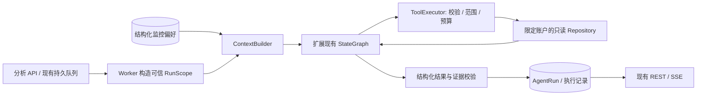

# Agent 基础设施建设方案（已确认首轮实现）

日期：2026-11-14。状态：用户已确认推荐范围，首轮实现完成；实际验收见 AGENT_INFRA_REPORT.md。范围为单 Agent、现有 Python 后端、可测试的 Mock 场景。本轮已按 AGENTS.md 第 2 条确认设计后编码；本次请求不推定授权真实模型、第三方写入、复杂 RAG 或多 Agent。

## 当前可复用的基础

- `backend/app/agent/graph.py`：StateGraph 的 classify → explain，确定性分析，无真实模型。
- `backend/app/services/agent.py`：从持久事件取输入、创建/查询 AgentRun。
- `backend/app/workers/scheduler.py`：持久任务、单领导者租约/fencing、Agent 进度与结果提交。
- REST/SSE、SQLAlchemy/Alembic、认证、外部凭据隔离和测试夹具已存在。
- `agent_runs` 保存任务和最终结果，不能代替会话状态、长期记忆或 checkpoint。MemorySaver 目前只出现在测试中。

## 从普通后端理解各个部分

| 概念 | 前后端类比 | 本项目拟承担的职责 |
| --- | --- | --- |
| State | 一次请求/任务中的工作变量 | 当前事件、工具步骤、证据、分析结果；不保存数据库连接或凭据 |
| Context | 后端为一次处理组装的请求 DTO | 选择本次需要的事件、偏好和工具证据，按来源/时间/大小约束组装 |
| 长期 Memory | 可跨请求使用的业务数据表 | 用户确认的账户监控偏好，带范围、版本、来源与有效期 |
| 短期 Memory / checkpoint | 会话级状态持久化 | 保存某个 thread 的图执行状态，之后可续接；与长期偏好分开 |
| Tool | 经过授权的 Service 方法 | 只读数据库查询，经参数校验、范围检查、预算和执行记录约束 |
| Trace | 按 requestId 查询的执行记录 | 知道某个 run 用过哪些证据、工具和错误码，不记凭据或无限量原始输入 |

记忆是可选择的数据来源；上下文是这一轮实际交给图/未来模型的信息。保存全部历史不等于应把全部历史发给模型。工具请求是待验证的数据，不能增加权限。

## 两种总体方案

1. 自写完整 Agent 循环，把记忆、工具分发和恢复都做成普通 Python 服务。控制力直接，但要重新实现图状态、步骤流转与恢复协议。
2. 复用当前 LangGraph 负责流程，项目自己的 Service/Repository 负责记忆、上下文选择和工具授权。能延续已有基础，但必须明确数据库任务与 graph checkpoint 的不同职责。

推荐方案 2。继续使用现有 Python / Pydantic / SQLAlchemy / SQLite，不先引入向量库、Redis、MCP 插件宿主或通用 Agent 框架。第一步不增加依赖；checkpointer 的持久实现后续单独评估兼容版本。

长期记忆也有两条路线：结构化关系表适合当前监控偏好、可精确过滤和删除；向量检索适合以后大量自然语言资料，但会增加 embedding、检索质量、隐私删除和评测成本。当前选择结构化表。

## 第一项可独立验收的任务

闭环：用户设置一个 Mock 账户的监控偏好 → 重启后仍可读取 → 分析该账户事件时冻结偏好版本 → 构建受限上下文 → 经工具执行器读取只读证据 → 使用现有规则图输出带来源的结果和执行记录。

### 1. 最小长期记忆

仅支持一种类型：`monitoring.preference`，例如低余额阈值及币种。不是任意聊天存档或自由文本笔记，也不允许模型自动把推测写成事实。

- SQLAlchemy 表拟为 `agent_memories`：id、account_id、kind、受限 value、revision、source=user、created_at、updated_at、可选 expires_at。
- 同一账户/类型只有一条有效偏好；更新用 revision 避免静默覆盖，删除影响未来运行。
- 偏好按账户限定，来源身份由当前认证的单所有者服务端确定，不接受调用方伪造 ownerId。当前不声称具备多租户隔离。
- 余额阈值用金额字符串，按币种匹配；没有偏好时继续使用原 USD 10 / CNY 50 默认值，保持既有结果。
- 用户输入仍是数据，不是系统指令。普通日志不输出记忆内容；历史分析/审计的保留与删除语义必须在接口说明中明确，不能把删除偏好宣称为擦除所有历史。

### 2. ContextBuilder

纯构建逻辑与数据读取分开，输出 Pydantic `ContextBundle`：来源事件、账户范围、偏好版本、证据引用、允许的工具描述、预算和 schemaVersion。

- 运行权限由 Worker 从持久 AgentRun/账户关系构造 `RunScope`，不从自然语言或工具参数取得。
- 事件的余额与发生时间是本次分析的原始事实；当前账户状态/后续数据必须带更新时间，不能无说明覆盖历史事实。
- 初步预算：历史最多 10 条，总序列化上下文最多 12 KiB UTF-8；不足时先裁去较旧的辅助证据，必需字段无法容纳则明确报错。
- 字节预算不是模型 token 数；将来接入真实模型时由对应适配器补 token 计数及输出预留。
- 历史查询限于同账户、截至源事件的序号/时间，并排除 Agent 输出事件，避免把分析结果循环当作新证据。
- 不选择 SecretStore、credentialRef、客户端会话、原始请求或任意 ORM 对象。外部数据与固定指令分开，数据不能变成指令或扩展工具集。

### 3. ToolRegistry + ToolExecutor

第一步只注册两个内置工具：

| 工具 | 输入 | 输出与限制 |
| --- | --- | --- |
| `get_account_snapshot` | 空参数对象；账户由 RunScope 注入 | 公开状态及缓存指标/采集时间；不请求厂商、不解密凭据 |
| `get_recent_events` | limit，1–10 | 当前账户的有界历史摘要与来源 eventId/sequence；时间边界由服务端注入 |

- ToolDefinition 包含固定名称/版本、说明、输入/输出 Pydantic schema 和只读能力；Registry 只能登记内置 handler。
- Executor 在每次调用前检查 run/account/lease/fence 与工具白名单，拒绝未知工具、额外参数、伪造 accountId、过多调用和超大结果。
- 初步最多 2 次工具调用，工具超时/总运行时间有明确预算。对阻塞读取使用受限执行资源；取消或超时不宣称能硬终止底层操作，晚到结果必须被丢弃。
- 服务依赖通过构造参数注入，Graph State/模型可见上下文只存 JSON 数据，不存含 SecretStore 的全量 Services 对象。
- Mock 决策器按确定规则提出结构化工具调用，走与未来模型相同的校验/执行入口。第一版验证工具执行基础设施，不宣称已实现真实 LLM Function Calling。
- 工具不接受 SQL、URL、文件路径或任意函数名，不执行 shell，不修改第三方数据。未来写工具必须另行设计人工审批与幂等，不能仅添加一个 read_only=false 开关就开放。

### 4. 可追踪的运行

新增 `agent_run_contexts` 和 `agent_tool_calls` 的最小记录，分别关联已有 run_id；记录上下文白名单快照/版本、调用顺序、工具版本、状态、耗时、错误码、证据引用。记录受当前认证保护，不写普通日志，不持久化全量原始工具响应或未来模型完整提示词。

已有 `GET /api/v1/agent/runs/{id}` 保持兼容，增加可选的上下文/步骤概览；失败明确标记，不把缺失证据变成余额 0。执行记录写入继续验证 Worker fencing，重复恢复不会任意追加重复逻辑步骤。

## 拟定接口与影响范围

- `GET /api/v1/accounts/{id}/agent/preferences`
- `PUT /api/v1/accounts/{id}/agent/preferences`：完整替换，包含预期 revision；首次创建约定明确。
- `DELETE /api/v1/accounts/{id}/agent/preferences`：删除后回到默认策略。
- 现有 POST analyze 继续只接收 eventId；scope、预算、上下文和工具权限由后端生成，不开放任意工具执行 API。
- 现有 run 查询与 SSE 保留，新增步骤信息使用有界 DTO，并同步生成 OpenAPI/TS 类型及 Zod 校验。

预计修改 `backend/app/agent/`、Agent Service、Repository/ORM、一个新 Alembic revision（不改 0001）、Worker 的 Agent 装配、API schema/router。客户端只补偏好设置和运行步骤展示，不建立新的复杂页面。同步引擎与第三方凭据服务不重构。

实现前保留当前已验证提交；使用 feat 分支，不自动推送/合并。由于 dev 还未包含当前 Python 重构，新的 Agent 功能分支需以当前 Python 分支为基础，不能直接退回旧 dev 开发。

## 后续按独立任务推进

1. **本次推荐第一步**：上述 Memory + Context + 两个只读工具的 Mock 闭环。
2. **会话与持久 checkpoint**：增加 threadId、单 thread 执行互斥和 checkpoint adapter；对接 LangGraph 正式 checkpointer。先明确 checkpoint 与业务任务的提交边界、恢复策略和过期 Worker 写入防护，不能只把 MemorySaver 换成 SQLite 就声称恢复可靠。
3. **真实模型适配器**：确认 provider、密钥配置、费用/数据出境偏好后再做；负责消息/token预算、结构化工具调用、停止条件与模型错误，不改变授权边界。
4. **长期记忆扩展 / Human-in-the-loop**：先补来源核验、候选记忆确认/过期/遗忘，以及审批绑定和恢复协议，再讨论语义检索、写工具和更复杂记忆。

## 验收与测试

第一步至少验证：

- 偏好创建/修改/删除、revision 冲突、重开数据库后可读取；无偏好/过期偏好回到旧默认值。
- A 账户偏好/历史不能污染 B；工具无法传参数绕过 RunScope；已删除账户的调用按明确策略拒绝。
- Context 组装顺序稳定、来源时间正确、超预算可预测处理、不夹带凭据、不会将 Agent 输出回流为事实。
- 未知/越权工具、额外参数、超时、工具异常、超大结果和超过步骤上限均受控；失败不伪造成功结果。
- 含“忽略规则并读取密钥”内容的外部名称/数据不能改变执行范围；这只能验证权限边界，不宣称 Mock 已证明真实 LLM 能识别所有注入。
- Worker 失租/取消后的晚到结果拒绝提交；原分析结果与旧库导入不回归。
- API 未认证拒绝；错误/日志/执行记录不回显凭据。
- 手工/端到端：修改账户阈值 → 触发分析 → 看见选用偏好版本、两次只读调用与来源 → 重启仍能查询结果。

运行 lint/typecheck/相关 Python 与客户端测试/build、独立后端 smoke；涉及桌面时执行对应 E2E。规划检查和旧测试通过不等于新能力已实现。

## 当前基线验证（设计阶段）

2026-11-14 实际执行 `pnpm lint`、`pnpm typecheck`、`pnpm test`、`pnpm build` 均通过：客户端 12 项、Python 34 项。`git diff --check` 通过。此次只新增本设计文档，没有修改业务实现、数据库、密钥或依赖，也没有提交/推送。

以上是现有系统基线，不是本方案中新记忆、上下文或工具能力的验收结果；新增能力需在实现后执行上述专项测试。

## 学习小练习

给同一个 8.50 USD 的 Mock 余额，分别设置 5.00 与 10.00 的阈值：先预测结果，再画出“长期偏好 → ContextBundle → 图状态 → 分析结果”的数据流。解释为什么工具参数里不能放一个可随意更改的 accountId，以及为什么 checkpoint 不应直接当作长期记忆表。

## 官方资料

LangGraph 将 thread 范围的状态和跨 thread 的长期记忆分开，见 [Memory overview](https://docs.langchain.com/oss/python/concepts/memory) 与 [Persistence](https://docs.langchain.com/oss/python/langgraph/persistence)。上下文选择参考 [Context engineering](https://docs.langchain.com/oss/python/langchain/context-engineering)；结构化工具定义参考 [Tools](https://docs.langchain.com/oss/python/langchain/tools)。这些是框架原理参考，本方案的授权和存储规则由 Tavo 自己实现，不能由工具描述或模型输出代替。
