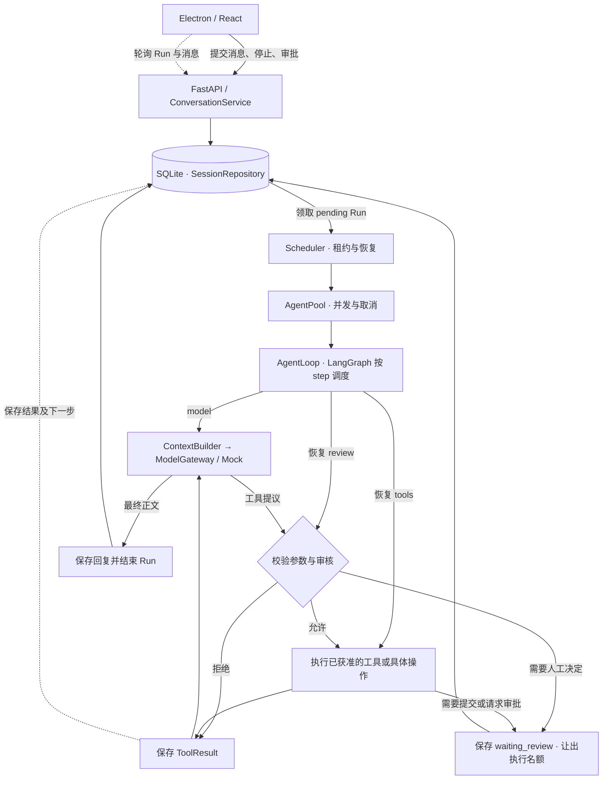

# Tavo AgentLoop 设计

2026-11-18 · 用户已确认，首期实现 · 基线 `826801f`

## 设计决定

把现有循环明确为 **面向单个 Run 的执行编排层**。继续用 LangGraph 执行模型、审核和工具三个步骤，由 SQLite 保存进度。桌面端继续提交消息、轮询状态和发出人工决定。Scheduler 负责领取和恢复，AgentPool 负责并发，Assistant 提供各步骤的业务实现。

基线已经具备这个循环。[graph.py](../backend/app/agent/graph.py) 原先用 `step` 和 `done` 决定走向，[assistant.py](../backend/app/agent/assistant.py) 同时负责图入口、异常收尾、清理和工具逻辑。[Scheduler](../backend/app/workers/scheduler.py) 已能从数据库的 `step` 恢复。原先的 `done=True` 可以表示「最终回答已完成」，也可以表示「本次执行先退出，等待审批」，两者只能再查数据库区分。首期用显式的步骤返回值拆清这些职责。

参考 Pi 将新轮次、已有上下文上的继续执行、工具结果反馈及退出分开处理的做法。Tavo 的继续执行由 Scheduler 从 SQLite 领取，其工具结果已经由原有事务提交。Pi 的循环入口和工具结果处理可在上游源码中对照阅读。[Pi Agent 循环源码](https://github.com/earendil-works/pi/blob/main/packages/agent/src/agent-loop.ts)

| 方案 | 取舍 |
| --- | --- |
| **A。保留 LangGraph，抽出清晰的 AgentLoop 边界** | 沿用当前图节点和恢复路径，为每步定义明确结果。改动集中，可复用现有测试和部署方式。 |
| **B。改成普通 Python 状态机** | 三个固定步骤可直接写成异步循环，依赖更少，单步调试直观。需要重新验证图的停止、恢复及预算行为，当前收益有限。 |

建议采用 A。对前后端开发者来说，AgentLoop 类似后台任务的流程引擎：它读任务进度，调用当前步骤的处理函数，并根据结果继续或让出执行名额。

## 架构与模块分工

| 模块 | 首期职责与接口 |
| --- | --- |
| `Scheduler`、`AgentPool` | 继续使用已领取的 `RunScope` 调用 `Assistant.run(scope)`，由后者转交 `AgentLoop.run(scope)`。Scheduler 决定何时领取或恢复，AgentPool 管本进程任务和资源占用。 |
| 新 `agent/loop.py` | AgentLoop 的入口。读取已持久化 `step`，驱动现有图，统一处理已知错误、取消和每次执行退出时的清理。它依赖已注入的步骤处理器及已有仓库/作用域检查。 |
| `agent/graph.py` | 保留模型、审核、工具三个节点。各节点返回 `Continue(next_step)`、`LoopExit.WAITING_REVIEW` 或 `LoopExit.COMPLETED`。开始时允许从三个已有步骤进入，运行中只有 `model → review → tools → model` 三条正常继续边。等待与完成都离开本次图执行。 |
| `Assistant` | 执行 `model(scope)`、`review(scope)`、`tools(scope)`，用已有事务保存该步骤的结果、状态和下一步。模型网关、审核器和工具 Runner 仍由 Assistant 组织。 |
| `SessionRepository` / SQLite | Run 的 `status`、`step`、`revision` 继续是权威状态。内部返回值只供本次图路由使用，重新领取以 SQLite 为准。 |
| `ContextBuilder` / `ModelGateway` | 用已选历史、当前用户消息、已保存的工具结果和授权范围组装输入。网关处理单次逻辑模型调用的 HTTP 重试、截断和脱敏。 |

首期保留现有 HTTP 契约、前端状态、迁移版本和原有步骤名。下一阶段可以从已有 Run 和工具记录派生「正在调用模型」「等待审批」「正在执行工具」等进度。用户可见的任务计划属于后续能力，宜作为可更新的进度描述，通过审核的 ToolCall 仍是实际执行依据。

## 每个步骤的输入和输出

| 步骤 | 步骤内行为 | 提交后的去向 |
| --- | --- | --- |
| `model` | 检查预算，构造上下文，标记模型轮次 `inflight` 再请求。成功时保存公开文本及结构化工具提议，私有续接数据沿用加密存储。 | 有工具提议就保存 `review`。只有最终文本就将 Run 置为 `succeeded`。 |
| `review` | 校验工具名、参数、权限和参数摘要。按当前权限模式决定是否进行模型复核或请求用户确认。 | 有待确认项就持久化 `waiting_review` 和恢复步骤 `tools`。否则进入 `tools`，拒绝项保存结果。 |
| `tools` | 只处理经现有规则获准的操作。每项结果与具体 `tool_call_id` 对应。执行中如出现需要审批的工作区提交或网络请求，保存待确认记录。 | 本轮工具结果齐备后推进到 `model`。需要人工决定则先退出。恢复时只处理剩余获准项或已批准的具体操作。 |

审批由原有 API 处理。比如同一轮有两项待确认，第一项批准后 Run 仍等待第二项。最后一项给出决定后才重新排队。拒绝也有 ToolResult，模型下一轮能看到动作未获准。并发和停止继续使用原有 Run 与资源机制，等待审批释放本次执行任务，未确认回收的资源仍占用相应名额。

## 恢复、预算与边界

- **事务与恢复**。先写入在途标记，完成后再写回结果和精确的下一步。外部调用期间释放 SQLite 写事务。新 Worker 只从已知状态继续。模型在途、宿主命令或外部操作的结果未知时沿用现有中断机制，避免自动重放可能已产生副作用的操作。租约及 `fence` 检查防止旧 Worker 在失去权限后提交晚到结果。
- **三种重试语义**。网关重试是同一轮模型请求里的 HTTP 尝试。等待审批后恢复是继续同一个 Run。用户点击「重试」则由现有 API 创建关联 Run，并复用原用户消息。三者在实现和日志中应有不同含义。
- **预算**。继续使用当前配置或冻结预算与运行时上限的适用规则，检查逻辑模型轮数、工具数、活动时间、上下文字节和重复失败。单次模型 HTTP 重试受该逻辑调用的剩余时间限制。人工等待与自己的审批过期规则分开。图自身的循环上限只是兜底。
- **工具与数据**。模型和工具返回内容都作为不可信输入。命令、文件和网络仍经已存在的审批、执行范围和运行时校验。计划、工具结果或外部文本里的指令无法授予新权限。工具输出、模型 Key 和私有思考沿用当前公开/私有边界。诊断优先使用步骤、耗时、数量和错误码。
- **退出语义**。正常结束、暂停等待和异常退出各有对应的持久化状态。终态更新仍检查当前租约以及 Run 是否仍在执行。取消可发生在模型调用、退避和工具等待期间。进程型工具的清理由已有执行器负责，因取消而结果不确定的外部操作需要按现有中断规则处理。

## 实施顺序与验收

1. **首期只收敛执行边界。** 在 `backend/app/agent/loop.py` 添加入口，调整 `graph.py` 的节点返回值和路由，`assistant.py` 保留外部入口及业务步骤。先以已有 Mock 回路验证「文本直返」「工具后再回答」「等待后恢复」。保留现有记录格式，有效旧 Run 仍可以从三种已有步骤进入。
2. **补上有区分度的回归。** 验证完成与让出执行名额是不同结果。测试重启后从 `review` 或 `tools` 恢复，没有发出额外的模型请求或重复已完成的工具。验证多项审批、拒绝结果、过期审批、取消及失租后晚到结果。对未知外部执行验证中断。沿用下列测试覆盖预算、模型重试、旧库与各执行环境。
3. **可选后续。** 先验证首期，再判断是否需要公开阶段进度、任务计划及执行摘要。按真实使用问题决定是否扩展 API 或持久化结构。

验收包括 `pnpm lint`、`pnpm typecheck`、`pnpm test`、`pnpm build`，以及现有后端、模型烟雾测试和 Electron 审批/取消回归。优先复用 [Agent 恢复测试](../backend/tests/test_agent_recovery.py)、[Session 测试](../backend/tests/test_sessions.py)、[模型重试测试](../backend/tests/test_model_retry.py) 和 [旧库升级测试](../backend/tests/test_pool_upgrade.py)。新增的 [AgentLoop 回归](../backend/tests/test_agent_loop.py) 覆盖多项审批、领取部分完成的工具批次和非法转换。

首期变更集中在 `loop.py`、`graph.py` 和 `assistant.py`。异常收尾复用 `SessionRepository.finish`，它会把在途模型轮次标记为结果未知。新增回归用临时数据库与本地模型替身核对审批、恢复、工具次数和完整的模型历史。接管测试在数据库中构造第一个工具已提交的中断位置，用新 Scheduler 领取后验证只执行剩余工具。

| 实际执行 | 结果 |
| --- | --- |
| `pnpm lint`、`pnpm typecheck`、`pnpm build` | 通过。构建报出依赖中已有的 Rollup 注释警告。 |
| `pnpm test` | 前端 54 项与后端 330 项通过，后端 38 项按环境默认跳过。 |
| `node scripts/backend-smoke.mjs`、`node scripts/model-smoke.mjs` | 通过。覆盖独立服务、重启恢复、工具循环、本地模型 HTTP 链路。 |
| `TAVO_BROWSER_CHANNEL=chrome TAVO_TEST_DOCKER=1 pnpm exec playwright test` | 11 项通过。覆盖 Electron 的审批、取消、重启恢复及临时 Docker 和宿主工具流程。 |

模型验证使用本地替身。桌面验证在本机 macOS 上运行，本轮的实际容器和宿主结果来自桌面测试中的临时环境用例。

**小练习。** 假设模型提出两个工具调用，A 已获准执行，B 等待审批。当前批次保存 `waiting_review`，B 被拒绝后 Run 恢复到哪一步，会调用哪一个工具，模型会收到哪两条结果？再分别考虑 A 已写入成功结果和 A 的结果仍未知的两种崩溃场景。
