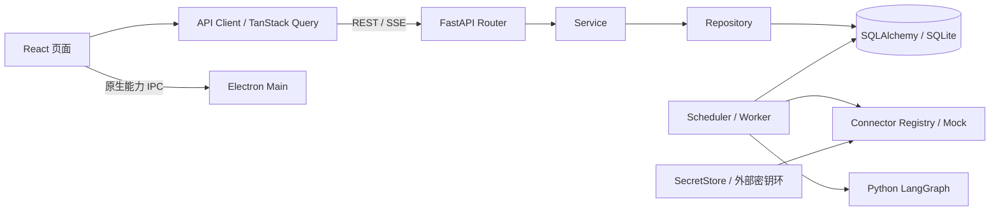

# Tavo 客户端与独立服务端架构

当前以 2026-11-13 Architecture Refactor 为准；旧架构保存在 `PHASE_1_ARCHITECTURE.md`，决策见 `ADR/0003-client-server-python.md`。本阶段只迁移 Mock 功能。

## 数据流

Main 不启动、停止或导入后端业务。HTTP 与桌面进程生命周期独立；本机开发可让 API 内嵌 Worker，Compose 使用 API / Worker 两个无桌面进程。Python 无 TS 包运行时依赖。

## 职责与接口

| 层 | 实际文件 | 输入 / 输出与状态 |
| --- | --- | --- |
| Electron | `apps/desktop/src/main/index.ts`、`backend.ts` | 管理窗口、托盘、通知、文件选择、本地连接配置、会话；没有账户/SQL/Agent IPC |
| React | `renderer/src.tsx`、`store.ts` | 展示快照和任务，Zustand 保存交互状态；Query 管理远端缓存、错误和刷新 |
| API Client | `renderer/api/client.ts` | 统一 URL、5 秒请求超时、错误映射、DTO 校验、SSE 重连；生成类型在 `generated.ts` |
| Router | `backend/app/api/routes.py` | Pydantic 请求/响应、分页与过滤、HTTP 状态和 SSE；不执行业务 SQL |
| Service | `backend/app/services/` | 账户授权状态、事务编排、事件查询、Agent 入队、迁移；使用 Repository 与 ORM |
| Repository | `backend/app/repositories/` | 查询、事件去重、账户分页、同步原子提交、数据库事务与租约检查 |
| ORM / Migration | `models/entities.py`、`migrations/` | 约束和结构由 SQLAlchemy / Alembic 管理；不在启动时 create_all |
| Connector | `connectors/registry.py` | Protocol + Registry + Mock；能力和最小读取权限、生命周期、标准错误、增量 SyncResult |
| Worker | `workers/scheduler.py` | 数据库队列、定时调度、全局/账户名额、重试、租约和恢复 |
| Agent | `agent/graph.py` | AnalysisInput → classify → explain → 结构化 Analysis，无模型和凭据 |

Service 内的 ORM 状态更新与 Repository 共享短事务；没有为每个简单字段建立空转发层。API/Worker 的同步 SQLite 访问仍可能短暂阻塞事件循环，当前只面向小规模本机数据，未做吞吐量评测。

## 持久模型

Alembic head `0001_backend` 独立于旧 Drizzle 版本 1/2。

- `connectors`：平台类型、能力与权限。
- `account_connections`：授权实例、状态、公开标识、凭据引用、增量 cursor、配置 revision；活动身份部分唯一。
- `account_data`：每账户最近成功数据；金额字符串，规则用 Decimal。
- `sync_tasks`：稳定 ID、pending/running/最终状态、尝试次数、nextAttemptAt、worker owner/fence；活动账户部分唯一。
- `business_events`：单调 sequence、稳定 eventId、eventType、sourceId、accountId、correlationId、受限 payload、去重键与分析。
- `secrets`：Fernet 密文及密钥版本；`app_settings`：同步设置。
- `agent_runs`：持久进度、结果、错误和运行归属；同事件活动分析部分唯一。
- `worker_lease`：唯一领导者、过期时间与递增 fencing token。
- `client_sessions`：短期会话摘要、到期时间与 bootstrap 指纹，不存会话原文。
- `legacy_records` / `legacy_secrets` / `import_records`：旧记录、不可用 OS 密文和迁移报告。

外键开启，WAL + busy timeout，写事务 `BEGIN IMMEDIATE`。固定错误消息及 SQL 参数隐藏降低敏感信息经异常泄漏的风险。数据库业务数据未整体加密。

## 一次同步

1. POST sync 在事务中检查账户状态和活动任务，创建 pending，立即返回 202 和 taskId。
2. Scheduler 获取/续租数据库租约，选取已到期任务；默认全局 2、同账户 1 个请求。
3. 短事务标记 running、增加 attempts、保存 owner/fence，并写 sync.started。
4. SecretStore 核对账户授权与 connectorId 后解密。网络/Mock 等待在事务外；返回先经 Pydantic 校验。
5. 同一事务重新检查租约、任务、账户与 revision，提交最新数据、cursor、成功状态、data.changed 与 sync.completed。
6. 错误映射成固定码，保留旧余额/游标；可重试错误将 nextAttemptAt 落盘。最多 3 次，1 秒起指数退避、上限 30 秒、50%–100% 抖动；模拟 Retry-After 优先，最多 1 天。
7. 新领导者先递增 fence，再恢复旧 running；过期执行者无法提交。正常取消/断开/改配置也会阻止晚到结果提交。忽略取消的请求保留名额至退出，避免同进程中重叠。

事务只保证本地原子性与幂等，无法保证外部 Exactly-once。初期连接器只读。崩溃恢复依赖租约到期（默认 30 秒）；多进程共享同一 SQLite 只能部署在同一主机本地磁盘，不能借此宣称分布式集群。

## REST、SSE 与 Agent

历史由 REST 分页读取；SSE 轮询持久业务事件，`id` 等于 sequence，支持 `after` / Last-Event-ID。重连可能重放，客户端按 sequence 去重，再让 Query 刷新。SSE 中断不会取消任务；最终状态由 taskId / runId 查询。轮询快照每 5 秒作为展示兜底。

Agent POST 只创建持久 run。Worker 用 Python StateGraph astream 执行 classify / explain，更新 10 → 50 → 90 → 100 进度并写 Agent 事件。结果与原事件分析同事务持久化。`create_graph(checkpointer=...)` 是扩展入口；MemorySaver 仅测试，生产持久 checkpoint、工具权限、长期记忆及 HITL 尚未实现。

## 安全边界

客户端 bootstrap 文件只由 Main 读取（禁止符号链接、0600），短期会话只留 Main 内存。原生网络钩子只向可信窗口请求的精确后端来源 `/api/v1/` 注入会话，跨来源时清除授权头。配置新地址必须原生选择该服务的凭据文件，失败回滚配置，不自动带旧凭据到新服务。

Renderer 为 contextIsolation + sandbox，nodeIntegration=false；6 个固定原生方法，sender 窗口/顶层 frame/完整 URL + Zod 校验。生产 `tavo://app` 提供精确后端 connect-src CSP；禁止任意导航、弹窗、webview、权限请求。开发 HMR 只在开发源放开必需脚本与 WebSocket。

后端所有业务端点认证，精确 Origin / Host / CORS、32 KiB 正文限制、固定错误响应；bootstrap 换短会话，摘要持久，旋转 bootstrap 撤销会话。第三方凭据只给受限连接器上下文，不给 Renderer 或 Agent。密钥环使用成熟 Fernet/MultiFernet，初始化/轮换取得同一数据库写锁，先发布新旧环再重加密，外部私有文件需独立保护和备份。

本阶段只有单所有者信任域；没有用户角色和租户隔离、生产 HTTPS 终止、认证限流审计、专用 KMS、密钥恢复 UI、数据库整体加密。Compose 只映射宿主回环端口，不能直接公开部署。

## 兼容与回滚

旧 Core/Storage/Connector/JS Agent、业务 IPC/safeStorage 适配器及重复 legacy 归档已按用户要求从工作区删除，原实现与学习注释保存在 Git 基线 `898328d`。Python 图已通过等价测试。当前共享契约为 `packages/shared/src/contracts.ts` 与 `workspace.ts`；只保留当前客户端校验和导入历史需要的数据形状，不保留 TS 业务存储/凭据/连接器接口。旧 SQL 原样保留在 `backend/tests/fixtures/legacy/`，哈希校验和 Python 迁移测试继续执行。清理范围见 `LEGACY_CLEANUP.md`。

旧数据库使用一致性备份后导入独立目标，不修改源。无法解密的 OS 密文原样保留、账户断开等待重新授权；旧 pending/running 同步取消，原状态保留迁移记录。回滚保留新数据与密钥，使用 Git 基线与原旧库；新数据没有自动反向转换。实际结果与命令见 `REFACTOR_REPORT.md`。
