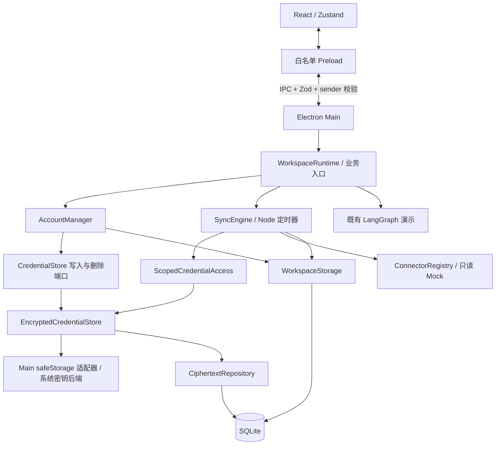
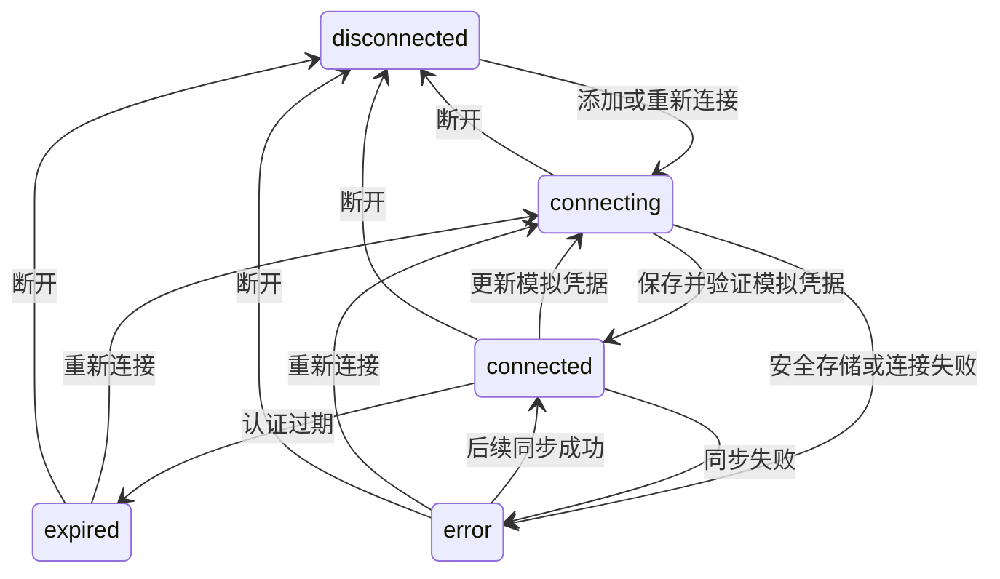
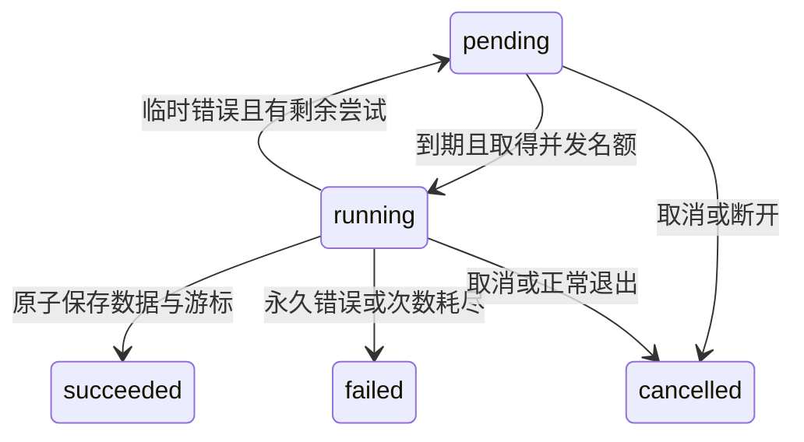

# Tavo 架构（Phase 1）

## 输入、输出和依赖

包依赖继续为 `core → connectors → shared`、`storage → shared`、`agent → shared`。Desktop 负责具体实现装配；Core 无 Electron / React 依赖。ElectronEncryptionProvider 在 Main，Core 只识别 EncryptionProvider 接口。业务包仍为 workspace TypeScript 源码，尚未发布为 SDK，也未新增 headless CLI。

`shared/contracts.ts` 保留原契约，`shared/phase1.ts` 定义新增 DTO、Zod Schema 和端口，`index.ts` 保留统一导入路径；没有把数据库或同步实现塞入 Shared。原 ApplicationRuntime、Graph、Event Bus 和测试保留，WorkspaceRuntime 承接新业务，旧全局 Mock 同步不再通过 Preload 开放。

## 数据模型与升级

| 实体 | 用途 | 关键约束 |
| --- | --- | --- |
| connectors | 连接器类型与能力 | ID 唯一，权限由内置宿主注册 |
| connections | 用户添加的账户连接 | 活跃 `(connectorId, externalAccountId)` 唯一；每连接独立 credentialRef/cursor |
| connection_data | 每连接最新余额、用量、资源状态 | connectionId 主键，严格归属、版本与结构校验 |
| sync_jobs | 新同步引擎的持久任务 | 同连接 pending/running 部分唯一索引 |
| business_events | 持久化业务事件 | 自增 sequence 排序、eventId 唯一、来源去重键唯一 |
| credential_records | 系统加密后的凭据字节 | reference 唯一，不保存原文或自定义加密密钥 |
| app_settings | 同步和启动设置 | 单例、严格 Schema |

Phase 0 的 accounts、events、sync_tasks 和旧分析保留，作为历史兼容数据；新功能统一写入连接模型，不继续写两套同步任务。版本 1 SQL 内容不变。新增版本 2 创建新表，将旧账户转换为已断开连接并保留最新数据。Activity 保留旧事件与分析入口。

所有迁移与 SHA-256 记录在排他事务执行，拒绝历史 hash 变化或未知版本。Schema、迁移、契约需同步维护；已交付迁移禁止修改。CredentialStore 的密文持久化与其他业务共享 SQLite，但普通 Snapshot 查询从不查询密文表。

## 账户状态与凭据生命周期

Core 中纯函数描述允许的转换，Schema 同时校验状态组合：connected 必须具备凭据且无错误；connecting 不具备可用凭据且无错误；disconnected 不具备凭据；expired 对应认证过期；error 有明确错误码。同步任务状态与连接状态分开维护，页面只读取业务服务结果。

添加账户先保存 connecting，再生成 `mock-only:` 前缀的随机模拟凭据。Renderer 只发送显示名称和公开模拟账户标识，不输入凭据。Main 中的安全适配器完成加密，随后 Core 验证可用并提交 connected 与事件。

断开先在事务中禁止继续同步、记录清理意图并取消任务；再终止执行、删除密文记录、完成断开或软删除。崩溃后继续处理 cleanupPending / deleteRequested。删除连接会清除最新数据，任务和事件保留；重新添加相同标识会生成新的实例与凭据引用。

CredentialAccess 根据数据库中的当前账户、连接器注册、只读权限和引用进行校验，只在回调作用域向可信内置连接器提供凭据，拒绝把原文返回为普通结果。它是宿主内部的权限约束，不是第三方任意代码沙箱。Agent 没有凭据端口。

## 同步状态机、调度和事务

- 请求先创建 pending 任务；`enqueue` 不等待网络，也不与 React 生命周期绑定。
- Main 启动 Node 定时器，每 250ms 检查到期任务和自动同步计划。默认两个全局名额，每账户一个活动任务。相同创建时间按 SQLite 入队顺序处理。
- 每次开始执行前持久化 running、尝试次数和 `sync.started`。请求有 AbortSignal 和默认 5 秒超时。
- NETWORK、TIMEOUT、RATE_LIMITED、SERVER_ERROR 可有限重试。默认最多 3 次尝试，退避基础 1 秒、指数增长、上限 30 秒，抖动 50%–100%；Retry-After 优先，防御性最大等待 1 天。
- 认证过期、权限不足、无效数据、安全存储错误不自动重试。认证错误进入 expired。自动调度不会持续重建永久错误的任务。
- 重试回到 pending，nextAttemptAt 和错误落盘，等待不占用工作 Promise。忽略取消的底层请求继续占用名额，防止与下一次请求重叠；晚到响应不再提交。
- 正常退出取消活动任务并等待受控执行结束；异常退出遗留 running，在下次启动按剩余尝试恢复只读 Mock，耗尽则标记 failed。没有外部 Exactly-once 保证。

原子提交顺序：校验任务仍在运行、账户仍授权 → 校验数据归属与版本 → 写最新数据 → 按实际内容比较产生 data.changed → 更新游标/成功时间/任务成功 → 写 sync.completed。全部在一个 SQLite 事务内。游标更新之后的事件写入失败也会回滚此前数据和游标，测试用 SQL trigger 注入该故障。

Mock 持久配置包含余额、币种、用量、资源状态和故障场景，修改数据才递增 revision。游标为该演示版本。相同版本返回空增量；同内容无新提醒；A→B→A 的两次真实变化分别记录。真实平台的分页和游标语义仍需各自设计。

## 系统运行事件与业务事件

Event Bus 用于进程内分发；普通函数调用和调度检查不写业务数据库。持久化事件由独立 EventRepository 管理，包含 eventId、eventType、sourceId、accountId、occurredAt、payload、correlationId、自增 sequence 和可选分析。

持久事件包括 account.connected/disconnected、sync.started/completed/failed、data.changed，以及 retry_scheduled/cancelled。一次任务的所有尝试共用任务 ID 作为 correlationId。变化按连接和来源版本去重，生命周期按任务/尝试去重。sequence 是明确排序依据，不依赖时钟精度。

事务成功后发布 `business.persisted`；观察者错误不改变已提交结果。进程在提交后、通知前崩溃时，持久记录仍在，但内存通知不保证重放；未来自动触发 Agent 需另加持久消费者进度和幂等，当前没有实现该机制。

保留的手动 Graph 仅接收从 data.changed 转换的白名单事件，运行 classify → explain，无网络和工具权限。分析保存于业务事件；旧余额事件仍走旧分析接口。MemorySaver 仍只用于测试，不是生产持久 checkpoint。

## IPC 与界面

Preload 只暴露 snapshot、analyze、addConnection、disconnect、removeConnection、reconnect、syncConnection、cancelSync、configureMock、updateSettings。没有通用 channel / SQL / 文件 / Shell / 凭据读取接口。Main 校验窗口所有权、主框架、精确 URL 和严格 Zod；Core 入口再校验业务参数与状态。

Renderer 使用 Zustand 缓存快照，约每 750ms 刷新展示；调度器即使关闭窗口仍在 Main 运行。Overview 显示计数、数据、最近事件；Connections 管理连接与 Mock 配置；Activity 显示任务、事件关联和旧历史；Settings 控制自动同步、间隔与下次启动隐藏窗口。所有页面提供加载、空、错误状态。启动隐藏窗口可通过 Dock 再显示；没有实现开机自启。

Renderer 维持 sandbox/contextIsolation/webSecurity、禁用 nodeIntegration；阻止导航、webview、弹窗和权限请求。生产 CSP 禁止外网与内联脚本，开发仅为本地 Vite HMR 放宽规则。

## 安全存储平台边界与限制

macOS / Windows 使用当前 Electron 的异步 safeStorage；Linux 为能核验后端，使用明确系统密钥后端对应的同步 API，拒绝 basic_text 和 unknown，不设置明文开关。同步 Linux API 的生命周期需在升级 Electron 前重新核对。每次读写都重新检查可用性；界面状态是启动检测结果。

macOS 保护依赖 Keychain 和稳定应用签名；Windows DPAPI 不隔离同一用户的所有进程；Linux 安全性依赖实际桌面密钥服务。当前只有 macOS ARM64 做了实际系统读写和打包后重启测试，其他策略通过替身验证。依据：[Electron safeStorage](https://www.electronjs.org/docs/latest/api/safe-storage)。

数据库访问暂为 Main 内同步调用；只验证小规模 Mock。Snapshot 限制为 200 连接/数据、200 任务、300 事件，无历史分页、归档和整体数据库加密。无法取消的请求可能占满工作名额，需要其结束或重启。尚未对跨进程 Worker、真实平台权限、系统休眠、签名安装与大规模性能做验证。
