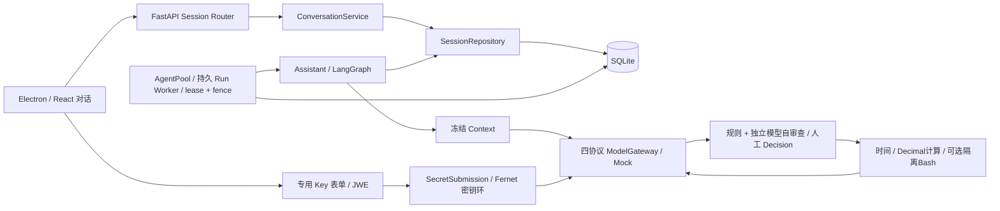

# Tavo 当前架构

> 当前客户端支持系统/浅/深主题、安全Markdown与左右聊天气泡，模型与命令权限在设置；这是展示层变更，后端策略5/head0008保持。见文末与[ADR0015](ADR/0015-chat-appearance-safe-markdown.md)。

> 2026-11-17 当前为策略5双命令入口，head0008_host_bash，见文末及 [ADR0014](ADR/0014-host-and-sandbox-execution.md)。旧会话/冻结策略1–4仍是Docker权限；新会话默认沙箱与真实后端宿主Bash、共享三档审批。此前各节保留历史背景。

2026-11-16：以持久 Session 驱动的 Agent 为核心。账户连接、余额、同步、事件分析与账户偏好功能已退出运行；旧表和原始迁移保留历史。最新启动决策见 [ADR0011](ADR/0011-bash-startup.md)，Agent设计见 [ADR0010](ADR/0010-agent-pool-self-review-bash.md) 和 [ADR0009](ADR/0009-session-agent-core.md)。此前 Phase/重构报告为历史记录。

## 数据流与职责

| 模块 | 输入、输出与权威状态 |
| --- | --- |
| Main / Preload | 窗口、托盘、通知、文件选择、后端配置与认证。六个固定原生方法；不代理业务 HTTP、读取 SQL 或运行 Agent |
| `renderer/chat/session-store.ts` | REST 查询、取消/重试/审核、轮询、游标分页；generation + AbortController 防止旧请求覆盖新会话。消息权威在后端，客户端仅缓存展示，localStorage 只记每个后端最后选择的 Session ID |
| `api/sessions.py` / `services/sessions.py` | Pydantic 请求/响应、认证与模型配置校验。只接受用户消息与明确的审核决定；不接受客户端伪造 AssistantMessage、ToolResult、Context 或系统策略 |
| `repositories/sessions.py` | 事务、排序/分页、幂等、每 Session 一个活动 Run、取消/重试、审核版本和结果唯一性 |
| `agent/assistant.py` / `graph.py` | model → review → tools → model 的 LangGraph；依赖注入 Gateway、Registry、Reviewer、ContextBuilder、Repository。持久步骤恢复，不声称是 LangGraph checkpoint |
| `agent/context.py` | 冻结所选完整成功轮次，重建各协议历史；64 KiB UTF-8 请求预算，最多选择最近 20 轮，再逐轮裁剪；不会只裁掉工具结果而保留调用 |
| `agent/tools.py` | 只读工具 `get_current_time`、`calculate` 的上下文只含时钟；新会话默认启用的 `bash` 经独立Docker执行器运行，无宿主或后端密钥权限 |
| `llm/adapter.py` / `turns.py` | 九家预设、四类协议。结构化 ToolCall 提议与关联结果，固定系统策略；真实认证仅在网关。旧 `/chat/completions` 保留无状态文本行为 |
| `workers/scheduler.py` | 持久队列、单领导租约与递增 fence、失租恢复、审核到期、并发名额；不读取旧 sync_tasks/agent_runs |
| `core/private_state.py` / `security.py` | 协议续接状态绑定 Session/Run/round/profile 后 Fernet 加密，密钥轮换包含该密文；API 不返回隐藏思考/签名/密文 |
| `models/legacy.py` | 仅迁移/归档 ORM 元数据。防止 autogenerate 误删旧表，不由活动业务服务导入 |

## 领域数据

Alembic head 为 `0007_sandbox_execution_policy`；0001–0006 与旧 Drizzle SQL 不修改。`init` 是增量迁移，不能用删库代替升级。

- `conversation_sessions`：模型/审核模式、标题、revision、sequence 分配、latest_run_id。
- `conversation_messages`：user / assistant / tool_call / tool_result 判别联合；Session 内 sequence 唯一，用户 clientMessageId 唯一。正文是普通文本。
- `assistant_runs`：持久状态、当前步骤、预算计数、冻结 Context、模型配置快照与 Worker owner/fence；活动 Session 部分唯一索引。
- `assistant_tool_calls`：原始 provider 调用关联、规范参数与 name/version/参数摘要、审核 revision、到期、attempts。
- `assistant_tool_results`：每个调用唯一的成功/失败/拒绝/取消结果。
- `assistant_reviews`：规则/人工 allow、deny、ask 审计，绑定摘要与策略版本。
- `assistant_model_turns`：轮次、inflight/completed/unknown、加密私有协议续接。
- 保留 `model_profiles` / `model_catalog_state`、`secrets` / `credential_states`、认证 `client_sessions`、`worker_lease`。
- 旧账户/余额/任务/事件/偏好/分析/导入表完整保留，不再执行旧队列。旧路由返回 410 FEATURE_REMOVED。

Session 是对话容器；`client_sessions` 是认证摘要，两者独立。Assistant 是注入依赖的运行对象，不为名字另建空表。Context 是本轮输入选择，不是所有历史，也不等于长期记忆。

## 执行、审核与恢复

入队事务同时写 UserMessage、Run、Session revision。重复 clientMessageId + 相同内容返回原结果；不同内容冲突。显式重试创建关联 Run 并复用原 UserMessage，不重新插入用户文本。新对话/切换模型或工具模式只切换展示并创建新的会话；后台旧运行继续，停止按钮才持久取消。

`auto_readonly` 仅放行注册的合法只读工具；`ask` 先做同样的规则检查，再持久等待人工确认，释放 Worker 名额；`disabled` 不声明工具。人工只提交 approve/reject/expectedRevision，不能改名或改参数。审核 10 分钟过期；批准前与执行前校验参数摘要，未知工具和非法参数不能靠人工升级权限。拒绝也产生关联 ToolResult，供模型解释。

模型请求前持久记录 inflight；若进程丢失了响应，下次领导者标记 unknown/interrupted，不自动重复付费请求。已持久模型提议可从审核/工具步骤继续。工具当前仅只读，未确认的执行最多恢复两次；已保存结果复用。每次写回重新验证 lease、fence、Run 状态；取消/失租后的晚到响应丢弃。

预算：每 Session 一活动 Run，进程并发 2；每 Run 4 轮模型、8 个工具、活动时间 180 秒（人工等待不计），模型等待至多 60 秒/响应 256 KiB，参数 4 KiB，工具等待 2 秒/结果 8 KiB。工具线程不能硬杀，超时后仍保留名额至真正结束。预算是受控上限，不是实时 SLA 或外部 Exactly-once。

## 模型与凭据边界

OpenAI/xAI 用 Responses；Anthropic 用 Messages；Gemini 保留 generateContent；DeepSeek/Qwen/Kimi/Zhipu/OpenRouter 用兼容 Chat Completions。所需 encrypted reasoning、thinking signature、thoughtSignature、reasoning_content/details 只在服务端加密续接，公开 DTO 无原始隐藏思考。模型响应回显真实 Key 时拒绝返回/落库。四协议由合成 HTTP 测试覆盖，不等于九家真实模型 ID 都支持工具。

客户端设置保留九家厂商、自填模型 ID、专用密码框。Key 只在提交期间进入该表单，Web Crypto RSA-OAEP-256/A256GCM JWE 上传，一次性挑战和 credential revision CAS 防重放/覆盖；服务端 Fernet 保存。模型配置和 Key 新增即时生效，保存不发厂商请求；不提供 saved-Key 读取。外部独立私有密钥环须和数据库一起保护/备份，无明文降级。

## 桌面与运行边界

`contextIsolation: true`、`nodeIntegration: false`、sandbox、严格 sender/IPC 校验和 CSP 保持；Renderer 通过 Zod 检查公开 HTTP DTO，Main 持有认证材料。窗口重启恢复最后选择会话，服务端退出时不会用本地缓存假装执行成功。新建离线 Mock 对话不会自动上传/合并到服务端。

非 token 流式 REST 轮询；持久状态是权威。API/Worker 可独立运行；Compose 分为两个进程，共享本机 SQLite 与外部密钥卷。同步 SQLite 短事务可能阻塞事件循环，尚未做大规模吞吐评测。当前单所有者，不宣称多租户、公网生产、RAG、自动长期记忆、MCP、多 Agent 或任意写工具。

## AgentPool与隔离Bash（0006，当前）

AgentPool管理有界Run task/取消/关闭/孤儿资源名额，Scheduler仍维护持久队列与lease/fence并只领取可用名额。Assistant线程池仅服务本地只读工具；Bash用标准库异步子进程调用Docker，无宿主shell拼接。

策略2的循环为模型提议→规则预检→每轮一次独立无工具模型自审查→后端合并→必要时人工→执行前校验→结果→模型。最多4次主模型和4次审核请求、8个工具，审核计入活动预算；连续重复失败/拒绝调用终止。规则/模型deny不能由人工升级，Mock复核明确标记。

Session的bashEnabled新会话默认true（纯文本false），历史会话/冻结Context保留原权限；内部workspaceUnconfirmed控制未知写操作后的确认。客户端启用开关已移除，auto_sandbox仍代表自动执行模式。auto_readonly只自动放行只读，Bash仍确认；ask逐次确认、disabled不声明工具。旧策略1冻结Context不扩大权限。AssistantModelTurn新增purpose，Context只重建assistant，self_review私有字段绑定用途后加密。Decision扩展model/mock来源与短摘要。

新增bash_executions记录稳定执行名/身份/owner/fence和生命周期；持久意图→create→再次校验→start→清理确认，未知写操作中断而不重播。未知工作区需要人工确认，旧执行清理前不可继续Bash；旧Worker关闭只清理自己的执行。文件副作用不保证回滚。

隔离Bash默认启用，每次短命容器，Session命名卷保留文件，无外网/宿主挂载/Key。真实资源配置和没有卷总容量配额等边界见 [BASH_TOOL.md](BASH_TOOL.md)。原Compose显式关闭Bash，不挂Docker socket；首轮Bash采用宿主Python Worker + Docker。`GET /agent-runtime`公开当前进程Pool统计与沙箱就绪状态，不是集群汇总。

0001–0005及旧账户历史保留，当前迁移/回归结果见 [AGENT_POOL_BASH_REPORT.md](AGENT_POOL_BASH_REPORT.md)。前文仅时间/计算的范围描述属于0005基础，Bash扩展以本节和ADR0010为准。

## Bash启动准备（当前优先）

`Services.initialize()`先等待`BashRunner.prepare()`，完成Docker CLI/daemon/隔离检查、缺失默认镜像的可信构建、固定命令的真实预热与清理；然后才初始化模型目录与Worker租约。ASGI lifespan和独立worker均在失败路径关闭Services，不开始监听或领取任务。`serve --no-worker`仍需准备；`init`/模型Key/轮换不经过该生命周期。

`probe()`仍是只读运行时探测，不构建或运行容器。`prepare()`只为缺失默认镜像构建（180秒/64KiB输出上限）；自定义镜像缺失不替换。预热复用实际调用的非root、网络/文件系统/资源限制参数，但无Session卷和宿主挂载，限15秒并核验归属清理；不是常驻共享容器。所有启动错误使用固定中文提示，不输出Docker原始日志。管理员显式关闭Bash可跳过；默认开启时Docker不可达即停止后端。实际结果见 [BASH_STARTUP_REPORT.md](BASH_STARTUP_REPORT.md)。

`core/startup.py`提供固定文案、立即flush的stderr阶段输出与每5秒等待心跳，独立于普通日志级别；退出阶段时取消并等待心跳，失败/取消不显示成功。镜像命中和缺失构建明确区分，清理确认后才显示沙箱准备完成。Main另报初始化完成，CLI开启Uvicorn info日志但仍关闭access log，以实际bind成功后的`Uvicorn running on`作为HTTP就绪提示；独立worker完成信号注册后提示就绪。没有新增DTO、进度API或客户端弹窗。见 [进度报告](BASH_STARTUP_PROGRESS_REPORT.md)。

## 策略3：脚本执行与受控出口（0007，当前）

`core/sandbox_config.py`加载管理员TOML，默认值单一来源为`sandbox/defaults.toml`。新Bash Run冻结资源与网络策略，恢复只能使用与当前配置交集。长参数从模型协议解析直到工具校验贯通；workspace_write分块写入长脚本，返回CAS摘要，不截断。结构化Bash结果与独立审计阶段区分参数/规则/模型/审批/执行/网络/清理。

LOW确定性本地操作免模型复核，MEDIUM脚本开发可在auto_sandbox执行；敏感意图复核/人工确认，宿主和网络越界不可批准。风险分类不是任意代码的静态安全证明，权限靠实际执行边界限制。auto_readonly/ask/disabled兼容原行为，旧策略1/2不升级权限。

SandboxManager以`sandbox_instances`和唯一活动slot维护每数据库1个执行容器，Scheduler/AgentPool仍负责Run与租约。Run内复用，取消/失租/残留子进程/空闲/结束回收；无法确认清理不释放slot。启动遇崩溃残留先在过期租约下受控接管并回收，未知Run中断不重放。普通Python代码由非root、network=none、只读根目录、seccomp/能力与cgroup限制的容器执行。

每Run独立工作副本，通过可信helper无symlink/hardlink跟随扫描，停止执行后创建快照，再以scope/fence和CAS推进Session checkpoint。大范围diff绑定内容摘要审批，拒绝不替换已确认文件；批准提交而不重跑。Session文件跨Run保持，未知副本保留。历史版本和原始Session卷不挂入用户执行容器。命名卷总量是监测/受控提交边界，不宣称统一存储硬配额。

网络默认none；代理模式时仅固定代码EgressProxy有出网，脚本经只读Unix socket调用tavo_http。精确域名/路径/方法/能力、公网地址检查、固定IP+TLS/SNI、逐跳重定向、无CONNECT/环境代理与限额共同实施出口控制。普通requests/curl不透明联网。请求计数先预留，封闭请求后核销，失联保留额度。系统Fake-IP正确拒绝，可由管理员明确选择可信DoH。

专用sandbox.api_key复用JWE/SecretStore/CAS与轮换，按目标能力绑定；仅代理注入，不向脚本、LLM、工具结果或日志提供原Key。POST等具体请求存加密意图，内部http_request ToolCall经现有Decision审批，展示精确目标/方法/路径/body与摘要；批准只执行该请求，结果加密保存，未知外部结果不自动重发父脚本。所有内部调用也计预算并重建四协议历史。

0007新增sandbox_instances、sandbox_operations、sandbox_network_requests、sandbox_workspace_checkpoints。Python镜像哈希锁定基础依赖，额外wheel通过受控代理/哈希/临时区与任务依赖目录安装，不改宿主venv。客户端只增相关凭据用途、审批预览及契约，六个原生方法不变。完整配置、默认资源、已知限制和实际结果见[指南](BASH_EXECUTION_POLICY_GUIDE.md)与[验收报告](BASH_EXECUTION_POLICY_REPORT.md)。

## 2026-11-17：策略4命令权限与默认公网

新会话默认full_access，另有auto_review、request_approval，仅控制Bash审核。其他合法工具调用自动执行，Registry校验、RunScope、租约/fence、资源配额及工作区提交仍由原模块负责。Context标记4并冻结网络权限；旧模式/策略1/2/3/待批准记录保留原义，无数据库结构变更。

默认proxy、allow_public_https=true、require_write_approval=false。tavo_http将URL拆为origin/path，通过原UDS网关校验、解析全地址并固定公网IP+TLS/SNI，允许GET/HEAD/POST/PUT/PATCH/DELETE。执行容器仍network=none。任意URL没有保存的凭据；绑定别名继续验证目标/路径/方法，专用Token由可信代理注入。当前配置与冻结权限取交集，管理员可即时收紧。普通自动请求不保证外部Exactly-once，调用方仍需幂等键及结果核对。

LLM四协议与文本聊天共享正文表达规范：不主动介绍内部工具，真实描述任务结果。Mock相应调整，独立审计不隐藏。细节见[ADR0013](ADR/0013-command-permissions-public-egress.md)及[本轮报告](PERMISSION_NETWORK_REPORT.md)。

### 同日DNS默认值修复

实际DeepSeek请求已是策略4/full_access/proxy，但系统DNS仍返回Fake-IP，关闭代理全局模式也未改变结果。默认解析改为现有cloudflare-doh，不新增网络通道：只由可信出口通过固定公网IP与Cloudflare域名TLS查询DNS，所有目标地址仍经公网/保护网段校验。管理员显式system配置与旧Run冻结保持。见[DNS_DEFAULT_REPORT.md](DNS_DEFAULT_REPORT.md)。

## 策略5：沙箱与真实宿主命令（0008）

Registry对新会话声明sandbox与host_bash，由Agent选择；旧bash仅给旧范围/冻结策略作为Docker兼容入口。两目标共同进入三档审核、Run工具/轮次/时间与重复失败预算；其他工具不变。Session.execution_scope持久隔离新旧能力，已有行sandbox_only，新三档新会话host_and_sandbox，Context策略5冻结hostPolicy。

HostBashRunner经Services注入Assistant，独立HostExecution表与唯一活动slot加入AgentPool/Scheduler。标准库监督器、结果FD、父管道/心跳和进程组管理正常子进程；恢复核对执行ID/监督路径/组归属，不凭旧PID误杀，不重放未知写入。已知凭据流式/发布前检查不等于OS秘密隔离，宿主按后端当前用户实际权限执行。客户端审计明确目标，生成契约与Zod同步；无新原生IPC。见[ADR0014](ADR/0014-host-and-sandbox-execution.md)和[报告](HOST_SANDBOX_TOOLS_REPORT.md)。

## 客户端外观与 Markdown 展示（2026-11-17）

Renderer appearance 模块独立维护 system/light/dark，默认跟随系统；localStorage 仅为该功能保存公开偏好，异常时降级内存，matchMedia 变化实时应用 CSS 语义变量。主题不进入 Session/Context，不影响模型或命令权限。

Chat 使用左右消息气泡与同一底部长条 Composer。ConnectionSettings 组合外观、对话模型/权限和原有连接/Key组件；选择器变更仍调用原 changeModel/changeReview，历史、停止/重试和审批保持。工具记录进入消息滚动区，待审核自动展开且页头可定位。

后端原始字符串 → MarkdownMessage → react-markdown/remark-gfm → React 节点，仅适用于助手正常回复。HTML 不渲染、代码不执行、图片不自动加载；用户及工具文本不解析。代码/表格局部滚动、任务项只读，表格无内联样式。合法外链经 Renderer + Main 的 URL 校验后由用户点击交系统浏览器，Electron 子窗口和页面导航仍禁止；无新 IPC、CSP 放行或后端协议变更。实现取舍见[ADR0015](ADR/0015-chat-appearance-safe-markdown.md)，实际验证见[报告](CHAT_APPEARANCE_MARKDOWN_REPORT.md)。

## 模型HTTP重试与错误分类（2026-11-17）

Settings.model_retry → Services → ChatService → ModelGateway，文本/Agent/模型审核共用有界请求循环。初次＋最多3次，全部尝试共用原模型60秒/审核30秒及Run剩余时间，异步退避/读取可取消。合法工具调用仅在网关成功返回一次后交原审核执行；重试不增加消息或逻辑轮次，不重放工具。

支持的DeepSeek模型显式保留思考，只有length且无公开正文/完整工具调用时，初始2048可按4096/8192/16384增长。初始profile/SQLite约束、旧Context、Worker未知请求恢复保持；其他厂商不扩大预算。MODEL_OUTPUT_LIMIT和MODEL_EMPTY_RESPONSE区分预算耗尽与空回复，旧拒绝/非法数据语义保持。

白名单model_request日志区分构造/传输/读取/解析/退避及次数/用量，不记录Key、正文、私有思考或会话ID。无新API请求字段、依赖或数据库迁移，生成契约经命令核对字节不变，客户端公共错误Zod同步。决策见[ADR0016](ADR/0016-bounded-model-retries.md)，指南MODEL_RETRY_GUIDE.md，实际结果MODEL_RETRY_OUTPUT_REPORT.md。

## AgentLoop 执行边界（2026-11-18）

Scheduler 领取符合租约的 Run，AgentPool 管理任务与名额，Assistant.run 转交 [AgentLoop](../backend/app/agent/loop.py)。AgentLoop 从 SQLite 的 `step` 进入 LangGraph，统一处理异常、取消和沙箱清理。Assistant 的三个步骤继续用原有事务写入运行状态和结果。

图节点返回 `Continue(next_step)`、`LoopExit.WAITING_REVIEW` 或 `LoopExit.COMPLETED`。正常边只按 `model → review → tools → model` 推进。等待审批退出本次执行，所有决定写入后同一个 Run 重新排队，从数据库中的 `tools` 恢复。恢复继续使用已提交的结果和参数摘要，遇到未知外部执行时沿用中断规则。架构图、接口和取舍见 [AgentLoop 设计](AGENT_LOOP_DESIGN.md)。
