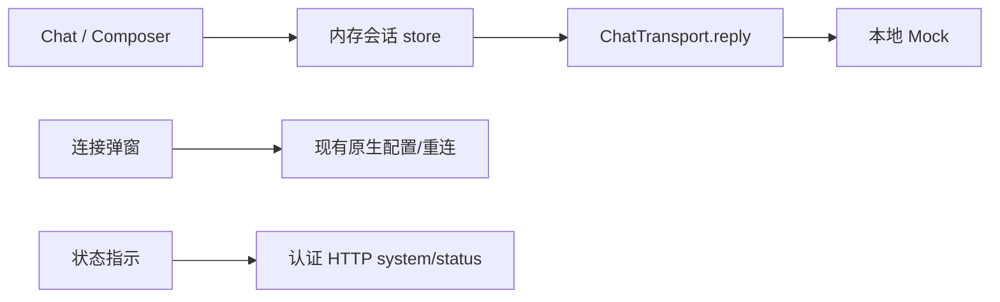

# 单页对话客户端重构报告

> 以下是 2026-11-14 Mock 首轮历史结果。2026-11-16 已按用户确认接入服务端模型目录/聊天、隐藏 Key CLI 和客户端加密凭据表单；当前说明与验证见 MODEL_SETUP.md / MODEL_PROVIDERS_REPORT.md / SECRET_SUBMISSION_REPORT.md，不能将本报告旧 Mock 范围当作当前全部能力。

2026-11-14（Asia/Taipei）。用户确认 CHAT_CLIENT_PLAN.md 方案 A 后实现。沿用本地 `feat/agent-foundations` 工作区，保留上一轮尚未提交的 Python Agent 基础设施；本轮未提交、推送、合并或发布，没有新增依赖。

## 当前体验

原五项业务导航与仪表盘已移除。客户端现在只有一个深色对话界面：空态欢迎语、居中输入与示例问题；发出消息后切为限宽消息流和底部输入区。顶部有新对话、真实后端连接状态和设置弹窗。采用 Tavo 自有名称/图形，不依赖外部图片、字体或 CDN。

输入支持自动增高、Enter 发送、Shift+Enter 换行、composition 组词保护，单条最多 4000 字符。可停止回复并重新生成，失败时提供重试；新对话清空消息和草稿。纯文本渲染，不执行消息中的 HTML。滚动到旧消息时不持续强制滚到底部。

回复来自本地 Mock，明确标注在输入框、助手消息与页脚。没有真实模型、自由问答或工具执行，不把任意消息发送给现有 analyze(eventId)。离线仍可体验 Mock；连接状态独立查询，不再加载业务快照/挂载业务 SSE。

## 文件变化与理由

| 文件 | 变化与理由 |
| --- | --- |
| `apps/desktop/src/renderer/src.tsx` | 只保留 React/Query 装配入口，五个旧页面不再挂载 |
| `renderer/chat/Chat.tsx` | 对话、输入、消息列表、状态与滚动；保持单页结构 |
| `renderer/chat/types.ts`、`store.ts`、`mock.ts` | 明确消息/适配器接口、可注入内存状态与 Mock，实现可测试的取消和异步竞争处理 |
| `renderer/connection.tsx`、`icons.tsx`、`styles.css` | 小型原生 dialog 语义连接设置、项目内 SVG、深色/窄窗口/减少动效适配 |
| 原 `renderer/store.ts` 与上一轮 `renderer/agent.tsx` | 移除不再使用的仪表盘状态/订阅 UI、偏好编辑及运行记录组件；原组件先保存于临时源码备份，后端 DTO/能力不删 |
| `apps/desktop/src/main/index.ts` | 背景与隐藏标题栏适配深色界面，最小窗口改为 620×540；其余认证、CSP、6 方法 IPC 与 Renderer 隔离保留 |
| `tests/chat.test.ts` | 新增 8 个有意义的状态/适配器测试，重点覆盖不理会 abort 的晚到响应和错误重试 |
| `tests/e2e/desktop.spec.ts`、`scripts/dev-smoke.mjs` | 改测当前对话交互；旧历史/Agent/退出后同步改由隔离 API 夹具检查，不能继续称为旧页面业务验证 |
| README、API/架构/规划、ADR 0005、学习/评测/开发记录、AGENTS | 记录真实客户端入口、后端保留范围、运行方式与未实现项 |

未因本次 UI 重构修改 Python API/Service/ORM、Alembic、生成契约或数据库；Git 中这些路径的既有未提交改动属于上一轮 Agent 实现。本次未初始化或迁移正常用户数据目录。

## 状态和接入边界

Message 包含 id/role/content/createdAt/status。store 只允许一个 pending 回复；输入只包含已完成消息，排除失败/取消的助手占位。重试替换最后一个失败/取消占位，不重复用户消息；适配器输出经 Zod 限制为 1–16000 字符，异常只显示固定消息。

停止先取消该请求的有效身份，再发出 abort。新对话清空会话并取消旧请求。即使适配器不理会取消，只有 activeRequestId 匹配才能保存回复；旧请求的 finally 也不能清除新请求。这与普通前端的搜索请求竞争相同。

窗口内存与 AgentMemory、graph checkpoint 分开：当前没有 localStorage/会话数据库。新对话、刷新、窗口重启或配置成功触发的 reload 会清空聊天。它们不删除后端账户、偏好、任务、分析或旧导入记录。

连接弹窗沿用 Main 的 profile/configure/reconnect；客户端不读取认证文件原文。非法远程 HTTP 在选择凭据和发请求前被拒绝，错误固定。Escape/关闭按钮先关闭 dialog，再将焦点返回实际打开入口。

## 实际验证

环境为 macOS arm64、Electron 44.11.1、Node 24.15.0、pnpm 11.1.3、Python 3.12.14。测试使用隔离目录/Mock 数据，浏览器文档使用已安装 Chrome。

| 实际命令 | 结果与范围 |
| --- | --- |
| `pnpm lint`、`pnpm typecheck` | 通过 ESLint / Ruff / Python 格式与 TypeScript 检查 |
| `pnpm test` | 通过：客户端 23 项（原 15 + 对话 8），Python 62 项 |
| `pnpm build` | 通过，Main / Preload / Renderer 构建完成 |
| `node scripts/backend-smoke.mjs` | 独立后端认证、REST、同步、SSE、偏好/上下文/两工具及重启持久化通过 |
| `pnpm test:dev` | 真实 Vite/Electron 窗口的对话、Mock 回复、新对话、连接设置和状态通过 |
| `TAVO_BROWSER_CHANNEL=chrome pnpm test:e2e` | 3 个当前桌面场景通过（41.0 秒），具体范围如下 |
| `pnpm package:dir` | macOS ARM64 未签名测试包生成成功，未发布 |
| `TAVO_BROWSER_CHANNEL=chrome pnpm test:packaged` | 最终包内 3 个桌面场景通过（46.0 秒），直接启动未签名 `.app` |
| `pnpm exec eslint scripts/dev-smoke.mjs`、`git diff --check` | 最后脚本就绪检查调整后通过 |

桌面场景：

1. 欢迎/示例消息、空白禁发、发送/换行、composition 回车保护、停止/重新生成、消息中 HTML 按文本显示、新对话期间晚到回复不复活、620×540 布局、原生桥接六方法与生产 CSP/Renderer 隔离。
2. 已认证本地 Swagger、连接地址/非法远程 HTTP 固定错误、Escape 焦点返回、后端停机后继续 Mock、失败重连与成功恢复、对话保留。
3. 窗口重启清空聊天；旧库导入事件仍可经 API 生成 Python 分析与两步工具记录，桌面退出后独立 Worker 继续定时同步，后端历史保留。

消息失败/异常脱敏/重试通过注入适配器的单元测试验证，未为演示界面添加隐藏失败命令。composition 测试是合成 DOM 事件，不代表所有实体输入法或辅助技术已验证。聊天没有真实模型质量或性能测量。

欢迎态、消息态、窄窗口、连接弹窗截图已目视检查。截图位于 `test-results/chat-desktop-*.png` / `chat-packaged-*.png`，属于可覆盖的本地产物，不纳入源码。

中途发现真实弹窗关闭后焦点未返回，已明确保存打开按钮并在 close 后恢复，通过 E2E 复验。开发烟雾首次在初始导航期间 5 秒超时；补充页面就绪等待时曾错误固定 localhost，随后改为验证实际回环主机名/测试端口与 DOM 就绪后通过，没有放宽业务断言。

构建仍有第三方 PURE 注释提示，打包提示默认图标/跳过签名；Playwright 有颜色环境提示，未导致最终失败。本轮没有重跑 Docker，Python 后端未因这次客户端改动而变化；上一轮 Linux 结果作为历史保留。

## 使用与剩余范围

仓库根目录 `pnpm dev` 打开对话。初始化过的 Python 服务可另用 `pnpm dev:backend` 启动，以便显示已连接状态；不启动后端也可体验本地 Mock。既有后端尚未升级时，按原说明备份数据/密钥后运行 `pnpm backend:init`，该步骤来自上一轮 0002 迁移。

未接入真实模型、流式 token、会话历史/多会话、文件上传、联网、模型选择或从聊天执行 Agent 工具。旧业务管理 UI 已移除，需要管理账户/偏好时使用现有认证 /docs；后续是否以聊天工具或其他界面恢复入口，应独立设计确认。

测试包未签名/公证，不构成正式分发；未验证 Windows、Intel macOS、其他桌面系统、完整无障碍或规模性能。不把后端旧历史保留误称为聊天持久化。

学习练习：先预测“请求 A → 停止 → 重试 B → A 晚返回 → B 完成”的 UI，再读 `tests/chat.test.ts` 核对。说明 busy、AbortSignal、requestId 分别保护什么，为什么客户端 messages 不是长期记忆。
