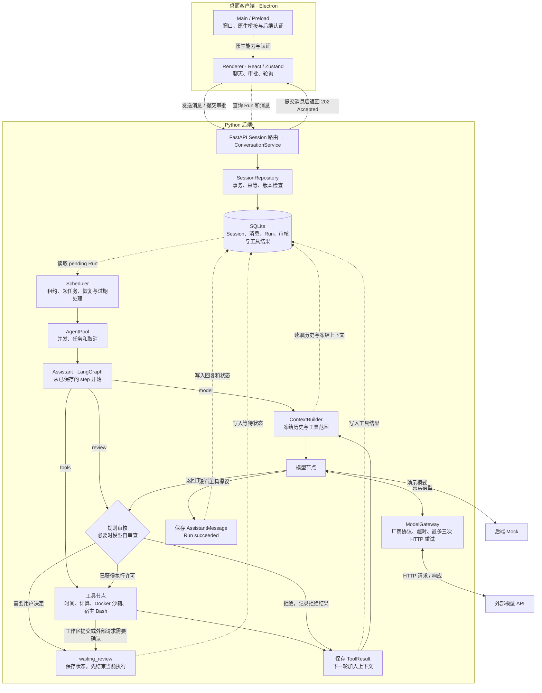

# Tavo 逐文件导读与 Agent 架构

这份导读对应提交 `826801f` 的 **273 个 Git 跟踪文件**。每个文件各有一行，生成件、测试和历史资料也收录在内。Git 忽略的本地数据库、密钥、依赖目录和构建产物不在清单内。导读本身写在该提交之后。

## 用你熟悉的前后端知识理解 Tavo

| 你熟悉的概念 | Tavo 中的对应位置 |
| --- | --- |
| 浏览器里的前端页面 | Electron **Renderer** 中的 React 页面。它显示消息、设置、工具记录和审批按钮。 |
| 桌面应用外壳 | Electron **Main** 管窗口、托盘、文件选择和后端认证。**Preload** 把少量原生能力桥接给 Renderer。业务请求由 Renderer 发 HTTP。 |
| Controller → Service → Repository | FastAPI **路由**接请求，**服务层**组织业务，**仓库层**把消息、任务和审批结果写入 SQLite。 |
| 发请求后交给后台处理 | 发送消息的 HTTP 请求返回 **202 Accepted**，表示本轮已入队。Scheduler 领取任务并交给 AgentPool，桌面端轮询状态和消息。 |
| 业务状态机 | LangGraph 决定接下来走 **模型 → 审核 → 工具 → 模型** 中的哪一步。SQLite 保存可恢复的执行状态，AgentPool 管进程内并发。 |
| 外部服务客户端 | ModelGateway 负责厂商协议、认证、超时和有界重试。模型可以返回文字，也可以返回工具提议。真正的执行由服务端审核并调度。 |

四个对象最容易混淆：

- **Session** 是一段对话，关联多条消息和多次 Run。认证也有 session，但它用于识别客户端，与对话 Session 单独存储。
- **Run** 是对一条用户消息的一次处理，有排队、运行、等待审批、成功、失败、取消等状态。点击重试可以创建关联的 Run，复用原用户消息。
- **Turn** 是 Run 里的一个逻辑模型轮次。一次 Run 可以经历多个 Turn，其中一次 Turn 的模型 HTTP 请求还可能因为临时错误而重试。
- **ToolCall / ToolResult** 是模型提出的操作及其实际结果。工具提议、审核决定和执行结果有各自的持久记录。

连接后端时，真实模型和后端 Mock 都走持久 Session 主线。离线 Mock 走 Renderer 的本地 store，适合预览界面和交互。

**第一次读代码可以按下面顺序。** 先用服务端 Mock 发一条 `计算 12 / 3`，打开回复下方的工具记录，然后沿文件追一遍。

1. [Chat.tsx](../apps/desktop/src/renderer/chat/Chat.tsx) → [session-store.ts](../apps/desktop/src/renderer/chat/session-store.ts) → [APIClient](../apps/desktop/src/renderer/api/client.ts)。看点击发送如何创建会话、提交消息、轮询更新。
2. [Session 路由](../backend/app/api/sessions.py) → [ConversationService](../backend/app/services/sessions.py) → [SessionRepository](../backend/app/repositories/sessions.py)。找出返回 202 前同一事务写入了哪些记录。
3. [Scheduler](../backend/app/workers/scheduler.py) → [AgentPool](../backend/app/agent/pool.py) → [LangGraph](../backend/app/agent/graph.py) → [Assistant](../backend/app/agent/assistant.py)。找出谁领取任务、谁限制并发、谁决定下一步。
4. [ContextBuilder](../backend/app/agent/context.py) → [后端 Mock](../backend/app/agent/mock.py) → [工具注册与审核](../backend/app/agent/tools.py)。找出为什么模型第一次给的是计算提议，第二次才给出答案。
5. 最后再看 [ModelGateway](../backend/app/llm/adapter.py)、[模型协议](../backend/app/llm/turns.py) 和 [模型重试](../backend/app/llm/retry.py)，把 Mock 换成真实模型时重点读这三个文件。

这里有两种常见的后端实现。同步接口会一直等模型和工具完成，代码路径短，但客户端断线后较难恢复状态。Tavo 采用先入队再轮询，额外维护 Run、事务和后台调度，因而可以暂停等审批，也能在重开桌面窗口后继续查看进度。小练习：在上面的计算例子里标出哪一步返回 202，哪一步把计算结果持久化，以及哪一步生成最终正文。

## 逐文件索引

### 仓库根目录与共享包

| 文件 | 用途 |
| --- | --- |
| [`.gitignore`](../.gitignore) | 忽略私有运行数据、依赖、缓存和构建产物。 |
| [`.npmrc`](../.npmrc) | 让 npm 兼容的包管理器保存前端依赖时使用精确版本。 |
| [`AGENTS.md`](../AGENTS.md) | 给开发者和 Codex 的协作、安全、阶段范围与验证要求。新增约定在靠后的章节。 |
| [`CODEX_START_PROMPT.md`](../CODEX_START_PROMPT.md) | 项目初期交给 Codex 的启动任务说明，保留原始实施背景。 |
| [`README.md`](../README.md) | 项目入口、当前能力、本地启动、基本使用和文档链接。 |
| [`TAVO_DEVELOPMENT_PLAN.md`](../TAVO_DEVELOPMENT_PLAN.md) | 仓库根目录保留的原始产品与开发规划，用于了解早期方向。 |
| [`compose.yaml`](../compose.yaml) | 容器模式的 init、API、Worker 分工，以及各自共享的数据和密钥卷。该部署关闭 Docker 命令沙箱。 |
| [`eslint.config.js`](../eslint.config.js) | JavaScript、TypeScript 和 React Hooks 的代码检查规则。 |
| [`package.json`](../package.json) | 定义 Node 和 pnpm 版本、公共开发依赖和启动、测试、API 生成等脚本。 |
| [`playwright.config.ts`](../playwright.config.ts) | 桌面端到端测试的目录、并发、超时和失败追踪设置。 |
| [`pnpm-lock.yaml`](../pnpm-lock.yaml) | 锁定前端工作区依赖及传递版本，保证安装可复现。 |
| [`pnpm-workspace.yaml`](../pnpm-workspace.yaml) | 声明工作区子包和允许执行依赖构建脚本的名单。 |
| [`tsconfig.json`](../tsconfig.json) | TypeScript 编译和严格类型检查选项。 |
| [`vitest.config.ts`](../vitest.config.ts) | Vitest 单元测试的文件匹配及运行配置。 |
| [`packages/shared/package.json`](../packages/shared/package.json) | 定义共享 TypeScript 包与导出入口。 |
| [`packages/shared/src/contracts.ts`](../packages/shared/src/contracts.ts) | 共享 Zod 基础字段、错误码、固定提示和 AppError。 |
| [`packages/shared/src/index.ts`](../packages/shared/src/index.ts) | 公开共享包的导出入口。 |

### 桌面应用与原生桥接

| 文件 | 用途 |
| --- | --- |
| [`apps/desktop/electron-builder.yml`](../apps/desktop/electron-builder.yml) | 控制 Electron 测试包的应用标识、文件范围、macOS ARM64 目标和签名设置。 |
| [`apps/desktop/electron.vite.config.ts`](../apps/desktop/electron.vite.config.ts) | 分别构建 Main、Preload、Renderer，配置 React、Tailwind 和本地开发服务器。 |
| [`apps/desktop/package.json`](../apps/desktop/package.json) | 桌面子包的依赖与开发、构建、打包命令。 |
| [`apps/desktop/src/main/backend.ts`](../apps/desktop/src/main/backend.ts) | 维护后端地址与认证状态，读取本机连接凭据，获取短期令牌并为受限后端请求加认证。 |
| [`apps/desktop/src/main/index.ts`](../apps/desktop/src/main/index.ts) | 主进程入口。创建窗口和托盘，注册 IPC、权限处理、应用页面协议和外链行为。 |
| [`apps/desktop/src/preload/index.ts`](../apps/desktop/src/preload/index.ts) | 用 Electron contextBridge 向网页公开固定的六个原生方法。 |
| [`apps/desktop/src/shared/links.ts`](../apps/desktop/src/shared/links.ts) | Renderer 与 Main 共用的 Web URL 和可信页面校验。 |

### Renderer 页面与聊天

| 文件 | 用途 |
| --- | --- |
| [`apps/desktop/src/renderer/index.html`](../apps/desktop/src/renderer/index.html) | 网页入口，提供 React 挂载点并加载前端模块。 |
| [`apps/desktop/src/renderer/src.tsx`](../apps/desktop/src/renderer/src.tsx) | 安装 React 和 QueryClient Provider，初始化主题并挂载 Chat。 |
| [`apps/desktop/src/renderer/env.d.ts`](../apps/desktop/src/renderer/env.d.ts) | 声明 Renderer 可见的原生桥接接口和环境类型。 |
| [`apps/desktop/src/renderer/appearance.tsx`](../apps/desktop/src/renderer/appearance.tsx) | 管理跟随系统、浅色和深色偏好，监听配色变化并提供设置控件。 |
| [`apps/desktop/src/renderer/connection.tsx`](../apps/desktop/src/renderer/connection.tsx) | 设置弹窗和后端连接状态，组织主题、对话选项、连接和模型配置。 |
| [`apps/desktop/src/renderer/icons.tsx`](../apps/desktop/src/renderer/icons.tsx) | 页面使用的图标与 Tavo 标识组件。 |
| [`apps/desktop/src/renderer/styles.css`](../apps/desktop/src/renderer/styles.css) | 聊天气泡、输入区、主题、设置、工具记录及 Markdown 的样式。 |
| [`apps/desktop/src/renderer/chat/Chat.tsx`](../apps/desktop/src/renderer/chat/Chat.tsx) | 主聊天页面。组装消息、输入、会话列表、模型设置、停止与审批交互。 |
| [`apps/desktop/src/renderer/chat/MarkdownMessage.tsx`](../apps/desktop/src/renderer/chat/MarkdownMessage.tsx) | 安全渲染助手 Markdown，处理代码、表格、脚注和外链。 |
| [`apps/desktop/src/renderer/chat/session-store.ts`](../apps/desktop/src/renderer/chat/session-store.ts) | 在线聊天的 Zustand 状态，调用 Session API、轮询 Run、分页聊天记录并隔离过期请求。 |
| [`apps/desktop/src/renderer/chat/store.ts`](../apps/desktop/src/renderer/chat/store.ts) | 本地对话状态和 ChatTransport 生命周期，目前用于离线 Mock。 |
| [`apps/desktop/src/renderer/chat/mock.ts`](../apps/desktop/src/renderer/chat/mock.ts) | 前端离线演示的假响应与可取消等待行为。 |
| [`apps/desktop/src/renderer/chat/http.ts`](../apps/desktop/src/renderer/chat/http.ts) | 把旧的无状态文本聊天 API 包装成 ChatTransport，供兼容路径和测试使用。 |
| [`apps/desktop/src/renderer/chat/types.ts`](../apps/desktop/src/renderer/chat/types.ts) | 定义本地聊天消息、传输接口、输入上限与固定提示。 |

### Renderer 接口与凭据

| 文件 | 用途 |
| --- | --- |
| [`apps/desktop/src/renderer/api/client.ts`](../apps/desktop/src/renderer/api/client.ts) | HTTP 请求封装，连接后端、调用接口、处理错误与运行时校验。 |
| [`apps/desktop/src/renderer/api/chat.ts`](../apps/desktop/src/renderer/api/chat.ts) | 校验模型目录和旧的无状态聊天回复。 |
| [`apps/desktop/src/renderer/api/model-profiles.ts`](../apps/desktop/src/renderer/api/model-profiles.ts) | 校验厂商目录、模型配置创建请求及返回项。 |
| [`apps/desktop/src/renderer/api/sessions.ts`](../apps/desktop/src/renderer/api/sessions.ts) | 校验 Session、Run、消息联合类型、工具结果、审批和运行状态。 |
| [`apps/desktop/src/renderer/api/query.ts`](../apps/desktop/src/renderer/api/query.ts) | 集中创建 React Query 客户端和查询默认选项。 |
| [`apps/desktop/src/renderer/api/generated.ts`](../apps/desktop/src/renderer/api/generated.ts) | 从后端 OpenAPI 生成的 TypeScript 接口类型，由 pnpm api:generate 更新。 |
| [`apps/desktop/src/renderer/security/AddModelForm.tsx`](../apps/desktop/src/renderer/security/AddModelForm.tsx) | 选择厂商、输入模型 ID 与显示名称并创建配置。 |
| [`apps/desktop/src/renderer/security/ModelKeySettings.tsx`](../apps/desktop/src/renderer/security/ModelKeySettings.tsx) | 展示模型配置和凭据是否就绪，组织新增模型和模型 Key 提交。 |
| [`apps/desktop/src/renderer/security/NetworkKeySettings.tsx`](../apps/desktop/src/renderer/security/NetworkKeySettings.tsx) | 按受控出口已配置的目标提供专用 API Key 提交组件。 |
| [`apps/desktop/src/renderer/security/SecretInput.tsx`](../apps/desktop/src/renderer/security/SecretInput.tsx) | 复用的密码输入和加密提交流程，处理清空、取消及提示。 |
| [`apps/desktop/src/renderer/security/contracts.ts`](../apps/desktop/src/renderer/security/contracts.ts) | 运行时校验凭据挑战、JWK 和加密提交相关字段。 |
| [`apps/desktop/src/renderer/security/secret-submission.ts`](../apps/desktop/src/renderer/security/secret-submission.ts) | 用 Web Crypto 将输入加密成 JWE，再提交给后端。 |

### 后端启动、配置与 API

| 文件 | 用途 |
| --- | --- |
| [`backend/.dockerignore`](../backend/.dockerignore) | 限制后端 Docker 构建上下文，排除本地数据、虚拟环境等文件。 |
| [`backend/.env.example`](../backend/.env.example) | 后端目录、认证、模型重试和执行能力的环境变量示例。 |
| [`backend/Dockerfile`](../backend/Dockerfile) | 构建 FastAPI 后端镜像，与执行用户脚本的沙箱镜像分开。 |
| [`backend/README.md`](../backend/README.md) | 后端运行、初始化、配置、测试及部署说明。 |
| [`backend/pyproject.toml`](../backend/pyproject.toml) | Python 版本、依赖、项目及 pytest/Ruff 配置。 |
| [`backend/uv.lock`](../backend/uv.lock) | 锁定 Python 依赖版本和包来源。 |
| [`backend/docker-entrypoint.sh`](../backend/docker-entrypoint.sh) | 容器启动时把命令及参数交给应用 CLI。 |
| [`backend/models.example.json`](../backend/models.example.json) | 兼容用模型配置示例，展示厂商、模型字段和预算。当前模型目录以 SQLite 为准。 |
| [`backend/sandbox.example.toml`](../backend/sandbox.example.toml) | 管理员可配置的沙箱、网络目标、依赖和宿主能力示例。 |
| [`backend/openapi.json`](../backend/openapi.json) | 导出的 API 契约快照，用于生成桌面端接口类型。 |
| [`backend/app/__init__.py`](../backend/app/__init__.py) | 初始化 Python app 包并关闭 LangSmith/LangChain 远程追踪。 |
| [`backend/app/cli.py`](../backend/app/cli.py) | 后端命令行入口，处理 init、serve、api、worker 和模型 Key 等运维命令。 |
| [`backend/app/main.py`](../backend/app/main.py) | 创建 FastAPI 应用，挂接路由、中间件和启动/关闭生命周期。 |
| [`backend/app/export_openapi.py`](../backend/app/export_openapi.py) | 从当前 FastAPI 应用导出 OpenAPI JSON。 |
| [`backend/app/api/__init__.py`](../backend/app/api/__init__.py) | 标记 HTTP API 包，文件为空。 |
| [`backend/app/api/base.py`](../backend/app/api/base.py) | Pydantic DTO 基类、通用字段类型和 API 的 camelCase 转换规则。 |
| [`backend/app/api/chat.py`](../backend/app/api/chat.py) | 提供模型目录和无状态文本聊天端点。 |
| [`backend/app/api/credentials.py`](../backend/app/api/credentials.py) | 提供一次性凭据挑战以及加密提交端点。 |
| [`backend/app/api/dependencies.py`](../backend/app/api/dependencies.py) | FastAPI 依赖注入函数，从应用取服务并校验客户端认证。 |
| [`backend/app/api/model_profiles.py`](../backend/app/api/model_profiles.py) | 提供厂商列表、模型配置目录和新增配置端点。 |
| [`backend/app/api/routes.py`](../backend/app/api/routes.py) | 汇总 API 子路由，提供状态和认证入口，处理退役功能路由。 |
| [`backend/app/api/schemas.py`](../backend/app/api/schemas.py) | 健康状态、认证会话与公开错误等跨业务响应结构。 |
| [`backend/app/api/sessions.py`](../backend/app/api/sessions.py) | 提供对话、消息、Run 查询、停止、重试、工具审批和运行状态端点。 |
| [`backend/app/static/SWAGGER_LICENSE`](../backend/app/static/SWAGGER_LICENSE) | 随仓库分发的 Swagger UI 静态资源许可。 |
| [`backend/app/static/swagger-ui-bundle.js`](../backend/app/static/swagger-ui-bundle.js) | 后端 API 文档页面本地加载的第三方 Swagger UI 脚本。 |
| [`backend/app/static/swagger-ui.css`](../backend/app/static/swagger-ui.css) | 本地 Swagger UI 页面使用的第三方样式。 |

### 后端通用基础、服务与存储

| 文件 | 用途 |
| --- | --- |
| [`backend/app/core/__init__.py`](../backend/app/core/__init__.py) | 标记基础设施模块包，文件为空。 |
| [`backend/app/core/config.py`](../backend/app/core/config.py) | 从环境读取后端 Settings，组装目录、Worker、执行能力和模型重试设置。 |
| [`backend/app/core/errors.py`](../backend/app/core/errors.py) | 定义后端错误码、公开错误消息和 HTTP 状态映射。 |
| [`backend/app/core/http_security.py`](../backend/app/core/http_security.py) | HTTP 边界中间件，校验来源和主机等请求条件并限制请求体。 |
| [`backend/app/core/json_data.py`](../backend/app/core/json_data.py) | 严格解析 JSON，拒绝重复键和非有限数字。 |
| [`backend/app/core/private_state.py`](../backend/app/core/private_state.py) | 加密模型协议续接等私有数据，并在读取时验证其绑定的上下文。 |
| [`backend/app/core/sandbox_config.py`](../backend/app/core/sandbox_config.py) | 定义并校验沙箱、宿主、网络及依赖策略，加载默认值和管理员配置。 |
| [`backend/app/core/security.py`](../backend/app/core/security.py) | 初始化和保护密钥文件、加密后端秘密、轮换密钥、签发并校验客户端短会话。 |
| [`backend/app/core/startup.py`](../backend/app/core/startup.py) | 输出启动阶段与等待提示，并提供工具阶段的审计日志入口。 |
| [`backend/app/services/__init__.py`](../backend/app/services/__init__.py) | 标记业务服务包，文件为空。 |
| [`backend/app/services/application.py`](../backend/app/services/application.py) | 组装数据库、认证、模型、会话、Assistant、命令执行及凭据服务，协调初始化和清理。 |
| [`backend/app/services/chat.py`](../backend/app/services/chat.py) | 为无状态文本聊天管理模型目录、Key、并发、断线与超时，调用共享网关。 |
| [`backend/app/services/model_profiles.py`](../backend/app/services/model_profiles.py) | 管理模型目录、创建配置和生成可公开的凭据就绪状态。 |
| [`backend/app/services/sessions.py`](../backend/app/services/sessions.py) | 对话业务的服务层，协调认证、模型可用性、消息与 Run 仓库操作。 |
| [`backend/app/models/__init__.py`](../backend/app/models/__init__.py) | 标记 ORM 模型包，文件为空。 |
| [`backend/app/models/base.py`](../backend/app/models/base.py) | 定义 SQLAlchemy ORM 基类。 |
| [`backend/app/models/entities.py`](../backend/app/models/entities.py) | 定义当前 SQLite 表的 ORM 类，包含 Session、Run、工具、模型、租约和凭据。 |
| [`backend/app/models/legacy.py`](../backend/app/models/legacy.py) | 保留退役业务表的 ORM 元数据，让迁移工具知道这些历史表。 |
| [`backend/app/repositories/__init__.py`](../backend/app/repositories/__init__.py) | 标记仓库层模块包，文件为空。 |
| [`backend/app/repositories/database.py`](../backend/app/repositories/database.py) | 建立 SQLite/SQLAlchemy 连接、事务和迁移入口。 |
| [`backend/app/repositories/sessions.py`](../backend/app/repositories/sessions.py) | 持久化会话、消息、Run、审核和工具结果，负责幂等、版本冲突与写入权限检查。 |
| [`backend/app/repositories/time.py`](../backend/app/repositories/time.py) | 为租约、审批过期等时间戳提供加秒函数。 |
| [`backend/app/workers/__init__.py`](../backend/app/workers/__init__.py) | 标记后台任务包，文件为空。 |
| [`backend/app/workers/scheduler.py`](../backend/app/workers/scheduler.py) | 凭租约认领排队 Run、维护并发与取消，处理过期审批及进程退出后的恢复。 |

### Agent 循环、审核与工具

| 文件 | 用途 |
| --- | --- |
| [`backend/app/agent/__init__.py`](../backend/app/agent/__init__.py) | 标记 Agent 模块包，文件为空。 |
| [`backend/app/agent/contracts.py`](../backend/app/agent/contracts.py) | 定义 Session、Run、上下文、类型化消息、工具、审批和执行范围的结构。 |
| [`backend/app/agent/pool.py`](../backend/app/agent/pool.py) | 限制进程内活跃 Run 数，防止重复占槽并统一取消与清理。 |
| [`backend/app/agent/graph.py`](../backend/app/agent/graph.py) | 搭出 model、review、tools 三个 LangGraph 节点，根据当前 step 继续或结束。 |
| [`backend/app/agent/assistant.py`](../backend/app/agent/assistant.py) | 实现图节点的业务逻辑，构造并调用模型→保存提议→审核→执行工具→继续模型。 |
| [`backend/app/agent/context.py`](../backend/app/agent/context.py) | 选取并冻结可复用的成功历史与工具范围，重建厂商协议消息，按上下文预算保留完整回合。 |
| [`backend/app/agent/mock.py`](../backend/app/agent/mock.py) | 后端可预测的模型替身，走真实会话和工具循环，适合本地练习。 |
| [`backend/app/agent/tools.py`](../backend/app/agent/tools.py) | 注册工具、声明入参/出参、校验提议，提供时间查询与十进制计算。 |
| [`backend/app/agent/bash_policy.py`](../backend/app/agent/bash_policy.py) | 判定工具风险和命令模式，给出允许、拒绝、询问或需要模型复核的决定。 |
| [`backend/app/agent/self_review.py`](../backend/app/agent/self_review.py) | 组装独立模型自审查请求，要求返回覆盖具体调用的结构化审核结果。 |
| [`backend/app/agent/bash.py`](../backend/app/agent/bash.py) | Docker 命令执行的参数、结果与 Runner，处理镜像准备、启动探测和执行适配。 |
| [`backend/app/agent/sandbox.py`](../backend/app/agent/sandbox.py) | 管理每个 Run 的执行容器、工作区快照、容量、恢复与回收。 |
| [`backend/app/agent/host.py`](../backend/app/agent/host.py) | 在 Python 后端所在主机执行 host_bash，管理执行记录、进程、输出保护和清理。 |
| [`backend/app/agent/host_supervisor.py`](../backend/app/agent/host_supervisor.py) | 独立进程监督器，负责 Shell 进程组及父进程失联、超时和回收的配合。 |
| [`backend/app/agent/egress.py`](../backend/app/agent/egress.py) | 服务端的沙箱出口协调器，管理受控代理、网络审批意图、配额和结果回传。 |
| [`backend/app/agent/api_credentials.py`](../backend/app/agent/api_credentials.py) | 管理绑定到指定网络目标的专用凭据及其加密提交入口。 |

### 模型网关与凭据提交

| 文件 | 用途 |
| --- | --- |
| [`backend/app/llm/adapter.py`](../backend/app/llm/adapter.py) | 统一文本与 Agent 模型 HTTP 请求，执行协议解析、响应限制、取消、有界重试和脱敏诊断。 |
| [`backend/app/llm/config.py`](../backend/app/llm/config.py) | 维护厂商端点/协议预设和模型配置校验。 |
| [`backend/app/llm/contracts.py`](../backend/app/llm/contracts.py) | 定义模型目录、配置、文本聊天请求、回复及 token 用量 DTO。 |
| [`backend/app/llm/keys.py`](../backend/app/llm/keys.py) | 管理服务端模型 Key，按模型配置及服务端点绑定密钥。 |
| [`backend/app/llm/prompts.py`](../backend/app/llm/prompts.py) | 放置文本与 Agent 请求共用的对话表达约束。 |
| [`backend/app/llm/repository.py`](../backend/app/llm/repository.py) | 读写 SQLite 模型目录，处理旧 JSON 的一次性迁入。 |
| [`backend/app/llm/retry.py`](../backend/app/llm/retry.py) | 定义模型重试参数、DeepSeek 预算递增、等待时间和安全日志元数据。 |
| [`backend/app/llm/turns.py`](../backend/app/llm/turns.py) | 把 Agent 历史和工具定义转成厂商请求，解析正文及结构化工具调用并重建续接格式。 |
| [`backend/app/credentials/contracts.py`](../backend/app/credentials/contracts.py) | 定义挑战、公钥、信封保护字段、提交与确认回执的数据契约。 |
| [`backend/app/credentials/envelope.py`](../backend/app/credentials/envelope.py) | 生成用于一次性挑战的密钥材料并校验、解密 JWE 信封。 |
| [`backend/app/credentials/handlers.py`](../backend/app/credentials/handlers.py) | 定义不同凭据用途如何解析目标、验证权限和保存的接口，包含模型 Key 处理器。 |
| [`backend/app/credentials/repository.py`](../backend/app/credentials/repository.py) | 管理凭据版本与删除墓碑，防止并发提交覆盖新版本。 |
| [`backend/app/credentials/service.py`](../backend/app/credentials/service.py) | 签发一次性挑战，绑定会话、用途和版本，验证并提交加密凭据。 |

### 数据库迁移

| 文件 | 用途 |
| --- | --- |
| [`backend/alembic.ini`](../backend/alembic.ini) | Alembic 数据库迁移工具的配置入口。 |
| [`backend/migrations/env.py`](../backend/migrations/env.py) | 把 SQLAlchemy 模型与实际数据库连接接入 Alembic。 |
| [`backend/migrations/script.py.mako`](../backend/migrations/script.py.mako) | 生成新迁移文件的模板。 |
| [`backend/migrations/versions/0001_backend_independent_backend.py`](../backend/migrations/versions/0001_backend_independent_backend.py) | 建立独立 Python 后端的首版数据库结构，包含历史账户业务等初始表。 |
| [`backend/migrations/versions/0002_agent_foundations.py`](../backend/migrations/versions/0002_agent_foundations.py) | 历史账户 Agent 的结构化记忆、上下文和工具记录迁移。 |
| [`backend/migrations/versions/0003_secret_submission_state.py`](../backend/migrations/versions/0003_secret_submission_state.py) | 增加凭据内容版本和删除墓碑，保留已有加密数据。 |
| [`backend/migrations/versions/0004_client_model_profiles.py`](../backend/migrations/versions/0004_client_model_profiles.py) | 增加持久模型目录及一次性旧配置迁入状态表。 |
| [`backend/migrations/versions/0005_session_agent_core.py`](../backend/migrations/versions/0005_session_agent_core.py) | 增加当前会话、类型化消息、助手 Run、模型轮次和审核工具记录。 |
| [`backend/migrations/versions/0006_agent_pool_bash.py`](../backend/migrations/versions/0006_agent_pool_bash.py) | 增加 AgentPool、自审查记录用途和 Docker Bash 执行意图相关结构。 |
| [`backend/migrations/versions/0007_sandbox_execution_policy.py`](../backend/migrations/versions/0007_sandbox_execution_policy.py) | 增加可复用沙箱、精确操作审批、网络审计与工作区快照记录。 |
| [`backend/migrations/versions/0008_host_bash.py`](../backend/migrations/versions/0008_host_bash.py) | 增加宿主命令执行与会话执行范围，旧会话保持仅沙箱。当前迁移 head。 |

### Docker 沙箱镜像与容器内代码

| 文件 | 用途 |
| --- | --- |
| [`backend/sandbox/Dockerfile`](../backend/sandbox/Dockerfile) | 构建运行受控 Python/Bash 任务及相关辅助程序的镜像。 |
| [`backend/sandbox/defaults.toml`](../backend/sandbox/defaults.toml) | 执行资源、网络出口、路径、工作区、Agent 预算和宿主能力的默认参数。 |
| [`backend/sandbox/requirements.in`](../backend/sandbox/requirements.in) | 沙箱基础 Python 依赖的直接输入清单。 |
| [`backend/sandbox/requirements.lock`](../backend/sandbox/requirements.lock) | 沙箱镜像安装依赖的固定版本和哈希。 |
| [`backend/sandbox/runtime/tavo_http.py`](../backend/sandbox/runtime/tavo_http.py) | 沙箱脚本导入的 HTTP 门面，转出受控请求类型和方法。 |
| [`backend/sandbox/runtime/tavo_pip.py`](../backend/sandbox/runtime/tavo_pip.py) | 经受控出口拉取已授权的包并校验哈希，安装到当前工作区的依赖目录。 |
| [`backend/sandbox/runtime/tavo_sandbox/__init__.py`](../backend/sandbox/runtime/tavo_sandbox/__init__.py) | 声明容器内辅助代码包和职责边界。 |
| [`backend/sandbox/runtime/tavo_sandbox/control.py`](../backend/sandbox/runtime/tavo_sandbox/control.py) | 可信内部控制通道，负责出口配置、状态、封存、审批请求执行及结果。 |
| [`backend/sandbox/runtime/tavo_sandbox/egress.py`](../backend/sandbox/runtime/tavo_sandbox/egress.py) | 在专用出口环境运行 Unix socket 服务，接收、转发或暂存需批准的 HTTP 请求。 |
| [`backend/sandbox/runtime/tavo_sandbox/http.py`](../backend/sandbox/runtime/tavo_sandbox/http.py) | 封装容器脚本到 Unix socket 的请求、响应及批准后结果读取。 |
| [`backend/sandbox/runtime/tavo_sandbox/network.py`](../backend/sandbox/runtime/tavo_sandbox/network.py) | 在可信出口端校验目标、URL、DNS、重定向和配额，实施受控 HTTPS。 |
| [`backend/sandbox/runtime/tavo_sandbox/supervisor.py`](../backend/sandbox/runtime/tavo_sandbox/supervisor.py) | 作为执行容器的常驻进程，等待终止信号，配合 Docker init 和后端回收。 |
| [`backend/sandbox/runtime/tavo_sandbox/workspace.py`](../backend/sandbox/runtime/tavo_sandbox/workspace.py) | 在辅助环境扫描、复制、快照和分块写入授权工作区。 |

### 后端测试与旧数据库夹具

| 文件 | 用途 |
| --- | --- |
| [`backend/tests/conftest.py`](../backend/tests/conftest.py) | 为测试创建临时数据库、密钥、认证客户端、可控时钟和应用实例。 |
| [`backend/tests/fixtures/legacy/README.md`](../backend/tests/fixtures/legacy/README.md) | 解释旧 SQL 夹具的来源、不可变约定和适用范围。 |
| [`backend/tests/fixtures/legacy/manifest.json`](../backend/tests/fixtures/legacy/manifest.json) | 记录旧 SQL 夹具原始位置、版本与 SHA256，供完整性测试核对。 |
| [`backend/tests/fixtures/legacy/phase0.sql`](../backend/tests/fixtures/legacy/phase0.sql) | Phase 0 的历史 Drizzle SQL，作为旧库结构的测试输入。 |
| [`backend/tests/fixtures/legacy/phase1.sql`](../backend/tests/fixtures/legacy/phase1.sql) | Phase 1 的历史 Drizzle SQL，作为旧库结构的测试输入。 |
| [`backend/tests/test_agent_pool.py`](../backend/tests/test_agent_pool.py) | 验证有界并发、重复认领拒绝、名额回收及关闭。 |
| [`backend/tests/test_agent_protocols.py`](../backend/tests/test_agent_protocols.py) | 验证多协议工具往返、加密续接、拒绝结果以及非法提议的处理。 |
| [`backend/tests/test_agent_recovery.py`](../backend/tests/test_agent_recovery.py) | 验证处理中断恢复、晚结果丢弃、上下文裁剪、预算与租约抢占。 |
| [`backend/tests/test_archive_upgrade.py`](../backend/tests/test_archive_upgrade.py) | 校验历史 SQL 哈希，并测试升级保留旧表和模型凭据。 |
| [`backend/tests/test_bash_boundaries.py`](../backend/tests/test_bash_boundaries.py) | 用替身验证命令参数、Docker 隔离要求、未知执行和容器清理边界。 |
| [`backend/tests/test_bash_sandbox.py`](../backend/tests/test_bash_sandbox.py) | 用实际 Docker 验证工作区持久化和隔离、资源上限、停止与清理。 |
| [`backend/tests/test_bash_startup.py`](../backend/tests/test_bash_startup.py) | 用替身验证启动预热、镜像构建选择、状态提示和失败清理。 |
| [`backend/tests/test_bash_startup_docker.py`](../backend/tests/test_bash_startup_docker.py) | 用实际 Docker 验证启动构建、预热和 HTTP 就绪顺序。 |
| [`backend/tests/test_bash_startup_process.py`](../backend/tests/test_bash_startup_process.py) | 用独立 CLI 进程验证 Docker 不可用时能明确报错并停止启动。 |
| [`backend/tests/test_command_permissions.py`](../backend/tests/test_command_permissions.py) | 验证三档命令权限、其他工具行为、旧会话兼容与表达约束。 |
| [`backend/tests/test_host_bash.py`](../backend/tests/test_host_bash.py) | 用临时目录执行真实宿主命令，验证输出、权限、并发、取消、超时和进程回收。 |
| [`backend/tests/test_host_contracts.py`](../backend/tests/test_host_contracts.py) | 验证宿主工具输入/输出、审核策略、旧会话迁移和进程身份核验。 |
| [`backend/tests/test_http_security.py`](../backend/tests/test_http_security.py) | 验证 HTTP 鉴权、来源、请求体、令牌过期及受保护文档页面。 |
| [`backend/tests/test_key_concurrency.py`](../backend/tests/test_key_concurrency.py) | 验证并发密钥轮换不会丢失可用密钥或损坏旧密文。 |
| [`backend/tests/test_model_profiles.py`](../backend/tests/test_model_profiles.py) | 验证模型目录即时创建、鉴权、容量、并发、旧配置迁移和密钥兼容。 |
| [`backend/tests/test_model_retry.py`](../backend/tests/test_model_retry.py) | 验证模型重试次数和预算、退避、异常分类、取消、脱敏及工具单次执行。 |
| [`backend/tests/test_models.py`](../backend/tests/test_models.py) | 验证九家预设请求契约、文本响应、错误、预算、取消及 Key 管理。 |
| [`backend/tests/test_pool_upgrade.py`](../backend/tests/test_pool_upgrade.py) | 验证从旧版本升级后仍能保留冻结上下文、密文和待确认记录。 |
| [`backend/tests/test_sandbox_development_docker.py`](../backend/tests/test_sandbox_development_docker.py) | 在真实容器中验证长脚本、Python 开发循环、沙箱复用、资源和工作区提交。 |
| [`backend/tests/test_sandbox_egress_docker.py`](../backend/tests/test_sandbox_egress_docker.py) | 在实际容器中验证受控公网、专用凭据、精确审批和哈希锁定包安装。 |
| [`backend/tests/test_sandbox_lifecycle.py`](../backend/tests/test_sandbox_lifecycle.py) | 验证沙箱/出口生命周期、容量、状态核销、清理确认和冻结权限。 |
| [`backend/tests/test_sandbox_network.py`](../backend/tests/test_sandbox_network.py) | 用合成请求验证公网地址、DNS、重定向、凭据与请求目标的边界。 |
| [`backend/tests/test_sandbox_policy.py`](../backend/tests/test_sandbox_policy.py) | 验证执行配置、风险分类、工作区快照、分块写入与特殊文件限制。 |
| [`backend/tests/test_secret_submissions.py`](../backend/tests/test_secret_submissions.py) | 验证凭据加密提交、挑战消费、鉴权、重放、版本冲突和迁移。 |
| [`backend/tests/test_self_review.py`](../backend/tests/test_self_review.py) | 验证模型审核可以拒绝或升级为人工确认，非法审核结果停止执行。 |
| [`backend/tests/test_sessions.py`](../backend/tests/test_sessions.py) | 验证持久 Session 聊天、工具循环、消息幂等、审批、取消和重试。 |

### 验证脚本与前端测试

| 文件 | 用途 |
| --- | --- |
| [`scripts/backend-harness.d.mts`](../scripts/backend-harness.d.mts) | 给 TypeScript 声明后端测试启动工具的接口。 |
| [`scripts/backend-harness.mjs`](../scripts/backend-harness.mjs) | 启动和重启临时 Python 后端，管理认证、临时数据目录及测试资源清理。 |
| [`scripts/backend-smoke.mjs`](../scripts/backend-smoke.mjs) | 验证独立后端的认证、持久对话、幂等、审批和工具闭环。 |
| [`scripts/bash-smoke.mjs`](../scripts/bash-smoke.mjs) | 通过真实后端验证容器 Bash、工作区和相关运行流程。 |
| [`scripts/dev-smoke.mjs`](../scripts/dev-smoke.mjs) | 打开开发模式 Electron，验证连接、模型新增、Key 上传和聊天。 |
| [`scripts/docker-smoke.mjs`](../scripts/docker-smoke.mjs) | 构建并启动 Compose 部署，检查服务就绪及容器模式业务闭环。 |
| [`scripts/host-smoke.mjs`](../scripts/host-smoke.mjs) | 使用临时工作目录检查宿主执行入口与安全状态查询。 |
| [`scripts/model-harness.d.mts`](../scripts/model-harness.d.mts) | 给 TypeScript 声明本地模型服务夹具的方法及记录形状。 |
| [`scripts/model-harness.mjs`](../scripts/model-harness.mjs) | 启动合成的本地模型 HTTP 服务，可制造延时/失败并记录请求。 |
| [`scripts/model-smoke.mjs`](../scripts/model-smoke.mjs) | 用本地模型服务验证文本和 Agent 链路、失败恢复、断线、Key 和模型续接。 |
| [`tests/appearance.test.ts`](../tests/appearance.test.ts) | 验证主题偏好、存储降级与 Markdown 外链规则。 |
| [`tests/chat.test.ts`](../tests/chat.test.ts) | 验证本地 ChatStore 的消息、输入上限、停止、重试和并发反馈。 |
| [`tests/client-api.test.ts`](../tests/client-api.test.ts) | 验证桌面 HTTP 客户端的请求路径、解析和错误处理。 |
| [`tests/contracts.test.ts`](../tests/contracts.test.ts) | 验证共享 Zod 基础契约、通用错误码和公开错误映射。 |
| [`tests/e2e/chat-appearance.spec.ts`](../tests/e2e/chat-appearance.spec.ts) | 在实际桌面窗口验证主题持久化、Markdown 渲染、安全链接和窄窗口。 |
| [`tests/e2e/chat-helpers.ts`](../tests/e2e/chat-helpers.ts) | 复用 Electron 启动、测试截图路径和设置选择操作。 |
| [`tests/e2e/desktop.spec.ts`](../tests/e2e/desktop.spec.ts) | 桌面集成回归，验证模型与 Key、聊天、历史、审批、隔离和连接。 |
| [`tests/model-client.test.ts`](../tests/model-client.test.ts) | 验证无状态模型客户端、取消、模型匹配与模型错误契约。 |
| [`tests/model-profiles.test.ts`](../tests/model-profiles.test.ts) | 验证客户端模型目录和配置字段的运行时校验。 |
| [`tests/secret-submission.test.ts`](../tests/secret-submission.test.ts) | 验证客户端加密信封、网络提交和输入清理行为。 |
| [`tests/session-store.test.ts`](../tests/session-store.test.ts) | 验证在线会话 Store 的请求顺序、轮询、分页、重试和过期结果隔离。 |

### 当前架构与操作文档

| 文件 | 用途 |
| --- | --- |
| [`docs/API.md`](API.md) | 列出当前 API、认证、会话/模型/凭据接口及错误语义。 |
| [`docs/ARCHITECTURE.md`](ARCHITECTURE.md) | 汇总当前结构及各阶段演进，阅读时以最新章节和实现为准。 |
| [`docs/DEVELOPMENT_PLAN.md`](DEVELOPMENT_PLAN.md) | 迭代计划和各阶段范围，开头更新说明用于识别当前版本。 |
| [`docs/EVALUATION.md`](EVALUATION.md) | 记载测试、实际环境验收及局限，包含不同阶段的历史结果。 |
| [`docs/GIT_WORKFLOW.md`](GIT_WORKFLOW.md) | 项目的 main、dev、feat 分支职责与提交习惯。 |
| [`docs/MODEL_SETUP.md`](MODEL_SETUP.md) | 讲解如何连接后端、在桌面配置模型与 Key，并列出排障办法。 |
| [`docs/MODEL_RETRY_GUIDE.md`](MODEL_RETRY_GUIDE.md) | 讲解模型自动重试、DeepSeek 单次生成上限、环境变量和脱敏日志。 |
| [`docs/BASH_EXECUTION_POLICY_GUIDE.md`](BASH_EXECUTION_POLICY_GUIDE.md) | 解释当前沙箱执行、Python、工作区、受控出口及配置方法。 |
| [`docs/HOST_BASH_GUIDE.md`](HOST_BASH_GUIDE.md) | 解释沙箱和宿主机 Bash 的区别、运行位置、权限和使用方法。 |
| [`docs/LEARNING_LOG.md`](LEARNING_LOG.md) | 随每轮开发追加的技术要点、取舍和练习。 |
| [`docs/LEARNING_NOTES.md`](LEARNING_NOTES.md) | 用前后端知识类比 Electron、Python API、契约与持久化等概念。 |

### 设计、验收与历史档案

| 文件 | 用途 |
| --- | --- |
| [`docs/AGENT_INFRA_PLAN.md`](AGENT_INFRA_PLAN.md) | 首轮 Agent 基础设施设计，范围是账户偏好、受限上下文和两个只读工具。 |
| [`docs/AGENT_INFRA_REPORT.md`](AGENT_INFRA_REPORT.md) | 首轮 Agent 基础设施的交付与验证。属于持久聊天改造前的历史。 |
| [`docs/AGENT_POOL_BASH_PLAN.md`](AGENT_POOL_BASH_PLAN.md) | 说明有界 AgentPool、模型自审查和隔离 Bash 的设计。 |
| [`docs/AGENT_POOL_BASH_REPORT.md`](AGENT_POOL_BASH_REPORT.md) | 记录 AgentPool、自审查、Docker Bash 的交付和首次验收。 |
| [`docs/BASH_DEFAULT_REPORT.md`](BASH_DEFAULT_REPORT.md) | 记录命令沙箱改为默认启用和移除早期 UI 开关的变更。 |
| [`docs/BASH_EXECUTION_POLICY_HANDOFF.md`](BASH_EXECUTION_POLICY_HANDOFF.md) | 记录沙箱策略开发暂停时的阶段进度和待验证事项。 |
| [`docs/BASH_EXECUTION_POLICY_PLAN.md`](BASH_EXECUTION_POLICY_PLAN.md) | 详细设计多级命令审核、结构化结果、容器复用和受控出口。 |
| [`docs/BASH_EXECUTION_POLICY_REPORT.md`](BASH_EXECUTION_POLICY_REPORT.md) | 记录策略3时的工作区、网络、受控依赖与实际环境验收。 |
| [`docs/BASH_STARTUP_PLAN.md`](BASH_STARTUP_PLAN.md) | 设计 Python 后端启动前检查 Docker、构建镜像和预热。 |
| [`docs/BASH_STARTUP_PROGRESS_REPORT.md`](BASH_STARTUP_PROGRESS_REPORT.md) | 记录启动反馈、等待心跳及区分预热完成与实际监听的验证。 |
| [`docs/BASH_STARTUP_REPORT.md`](BASH_STARTUP_REPORT.md) | 记录 Docker 启动前置检查和各类准备结果。 |
| [`docs/BASH_TOOL.md`](BASH_TOOL.md) | 早期 Bash Tool 指南，用于理解沙箱功能的历史入口。 |
| [`docs/CHAT_APPEARANCE_MARKDOWN_PLAN.md`](CHAT_APPEARANCE_MARKDOWN_PLAN.md) | 设计浅/深主题、聊天气泡、安全 Markdown 和简化输入。 |
| [`docs/CHAT_APPEARANCE_MARKDOWN_REPORT.md`](CHAT_APPEARANCE_MARKDOWN_REPORT.md) | 记录新界面、安全渲染、开发窗口和实际打包回归。 |
| [`docs/CHAT_CLIENT_PLAN.md`](CHAT_CLIENT_PLAN.md) | 旧多页界面收敛为单页 Mock 聊天的设计。 |
| [`docs/CHAT_CLIENT_REPORT.md`](CHAT_CLIENT_REPORT.md) | 记录单页聊天首版交付及输入法、停止和桌面验证。 |
| [`docs/CLIENT_MODEL_SETUP_PLAN.md`](CLIENT_MODEL_SETUP_PLAN.md) | 设计桌面自助新增模型、SQLite 目录和兼容旧模型配置。 |
| [`docs/CLIENT_MODEL_SETUP_REPORT.md`](CLIENT_MODEL_SETUP_REPORT.md) | 记录自助模型目录、Key 加密提交闭环及升级验证。 |
| [`docs/DEEPSEEK_RESPONSE_DIAGNOSIS.md`](DEEPSEEK_RESPONSE_DIAGNOSIS.md) | 记录 DeepSeek 思考用完 2048 tokens、正文为空及误报拒绝的诊断证据。 |
| [`docs/DEVELOPMENT_LOG.md`](DEVELOPMENT_LOG.md) | 保留从 Phase 0 开始的实施记录和后续变更轨迹。 |
| [`docs/DNS_DEFAULT_REPORT.md`](DNS_DEFAULT_REPORT.md) | 记录系统 Fake-IP 影响受控出口以及调整为默认 DoH 的验证。 |
| [`docs/HOST_SANDBOX_TOOLS_PLAN.md`](HOST_SANDBOX_TOOLS_PLAN.md) | 设计沙箱与宿主命令并存、共享三档审批和兼容历史会话。 |
| [`docs/HOST_SANDBOX_TOOLS_REPORT.md`](HOST_SANDBOX_TOOLS_REPORT.md) | 记录宿主命令的监督、恢复、迁移和实际测试结果。 |
| [`docs/LEGACY_CLEANUP.md`](LEGACY_CLEANUP.md) | 说明客户端/后端拆分后移除的旧 TS 业务、保留的历史与恢复位置。 |
| [`docs/MODEL_PROVIDERS_PLAN.md`](MODEL_PROVIDERS_PLAN.md) | 设计九家模型适配和服务端模型凭据方案。 |
| [`docs/MODEL_PROVIDERS_REPORT.md`](MODEL_PROVIDERS_REPORT.md) | 记录四类协议、错误映射、Key 安全和初次模型聊天的验证。 |
| [`docs/MODEL_RETRY_OUTPUT_PLAN.md`](MODEL_RETRY_OUTPUT_PLAN.md) | 设计最多三次重试、预算递增、错误分类和取消衔接。 |
| [`docs/MODEL_RETRY_OUTPUT_REPORT.md`](MODEL_RETRY_OUTPUT_REPORT.md) | 记录重试实现、全量测试和两次真实 DeepSeek 合成验收。 |
| [`docs/PERMISSION_NETWORK_PLAN.md`](PERMISSION_NETWORK_PLAN.md) | 设计三档命令权限、沙箱默认公网访问与对话表达调整。 |
| [`docs/PERMISSION_NETWORK_REPORT.md`](PERMISSION_NETWORK_REPORT.md) | 记录命令权限与出口策略分别管控后的实施验证。 |
| [`docs/PHASE_0_1_LEARNING_NOTES.md`](PHASE_0_1_LEARNING_NOTES.md) | 早期 Node 运行时、Electron、持久化和账户功能的学习材料。 |
| [`docs/PHASE_1_ARCHITECTURE.md`](PHASE_1_ARCHITECTURE.md) | 描述旧桌面本地运行时、账户同步及原生凭据架构。 |
| [`docs/PHASE_1_REPORT.md`](PHASE_1_REPORT.md) | 旧账户/同步 Phase 1 的交付、使用范围和验证结果。 |
| [`docs/REFACTOR_PLAN.md`](REFACTOR_PLAN.md) | 规划客户端和独立 FastAPI 后端拆分、数据迁移及回退。 |
| [`docs/REFACTOR_REPORT.md`](REFACTOR_REPORT.md) | 记录 Python 后端上线、旧实现清理和数据迁移阶段验证。 |
| [`docs/SECRET_SUBMISSION_PLAN.md`](SECRET_SUBMISSION_PLAN.md) | 设计用加密信封和一次性挑战提交凭据，处理并发版本。 |
| [`docs/SECRET_SUBMISSION_REPORT.md`](SECRET_SUBMISSION_REPORT.md) | 记录凭据提交、失败路径、密钥轮换和验证结果。 |
| [`docs/SESSION_AGENT_REFACTOR_PLAN.md`](SESSION_AGENT_REFACTOR_PLAN.md) | 设计持久 Session 驱动的 Agent 核心及退役账户功能。 |
| [`docs/SESSION_AGENT_REFACTOR_REPORT.md`](SESSION_AGENT_REFACTOR_REPORT.md) | 记录新会话、真实模型工具循环、审批与旧库升级验证。 |
| [`docs/images/tavo-phase0.png`](images/tavo-phase0.png) | Phase 0 的历史桌面截图。 |
| [`docs/images/tavo-phase1.png`](images/tavo-phase1.png) | Phase 1 的历史桌面截图。 |

### 架构决策记录

| 文件 | 用途 |
| --- | --- |
| [`docs/ADR/0001-phase0-local-runtime.md`](ADR/0001-phase0-local-runtime.md) | 解释首版本地运行时与 Electron 权限边界的决策。 |
| [`docs/ADR/0002-phase1-connections-and-sync.md`](ADR/0002-phase1-connections-and-sync.md) | 解释旧多账户、安全凭据和持久同步的决策。 |
| [`docs/ADR/0003-client-server-python.md`](ADR/0003-client-server-python.md) | 解释为何将桌面客户端与独立 Python 后端分离。 |
| [`docs/ADR/0004-agent-memory-context-tools.md`](ADR/0004-agent-memory-context-tools.md) | 解释首轮结构化记忆、输入预算与只读工具的取舍。 |
| [`docs/ADR/0005-chat-client.md`](ADR/0005-chat-client.md) | 解释客户端先收敛成单页对话的决策。 |
| [`docs/ADR/0006-model-providers.md`](ADR/0006-model-providers.md) | 解释多厂商协议适配与密钥由服务端持有的决策。 |
| [`docs/ADR/0007-secret-submission.md`](ADR/0007-secret-submission.md) | 解释通用凭据加密提交、版本控制和删除墓碑的取舍。 |
| [`docs/ADR/0008-client-model-profiles.md`](ADR/0008-client-model-profiles.md) | 解释客户端自助配置和 SQLite 持久目录。 |
| [`docs/ADR/0009-session-agent-core.md`](ADR/0009-session-agent-core.md) | 解释为何用持久 Session 与 Run 替换原账户事件 Agent。 |
| [`docs/ADR/0010-agent-pool-self-review-bash.md`](ADR/0010-agent-pool-self-review-bash.md) | 解释 AgentPool、模型自审查与隔离 Bash 的设计选择。 |
| [`docs/ADR/0011-bash-startup.md`](ADR/0011-bash-startup.md) | 解释为何后端启动时准备 Docker Bash 并检查预热结果。 |
| [`docs/ADR/0012-sandbox-execution-policy.md`](ADR/0012-sandbox-execution-policy.md) | 解释脚本开发、工作区管理、受控网络和执行策略演进。 |
| [`docs/ADR/0013-command-permissions-public-egress.md`](ADR/0013-command-permissions-public-egress.md) | 解释为何命令审批与公网访问分开配置。 |
| [`docs/ADR/0014-host-and-sandbox-execution.md`](ADR/0014-host-and-sandbox-execution.md) | 解释为何单独新增宿主执行入口并保留旧沙箱语义。 |
| [`docs/ADR/0015-chat-appearance-safe-markdown.md`](ADR/0015-chat-appearance-safe-markdown.md) | 解释主题存储、Markdown 安全与原生能力边界的选择。 |
| [`docs/ADR/0016-bounded-model-retries.md`](ADR/0016-bounded-model-retries.md) | 解释模型重试、生成预算、总超时和工具单次执行的取舍。 |

## Agent 架构图

图中实线表示请求或执行顺序，虚线表示读取、写入或轮询。图中的“工具获准”包含规则直接放行、模型复核后放行或用户审批后放行。

需要人工决定时，Run 会持久化为 `waiting_review` 并释放当前执行名额。等本轮待审批项全部处理完，仓库把 Run 改回 `pending`，Scheduler 领取后从保存的工具步骤继续。已经拒绝的调用只留下结果。失败和取消同样写入 Run，前端用相同的 HTTP 查询路径拿到状态。

