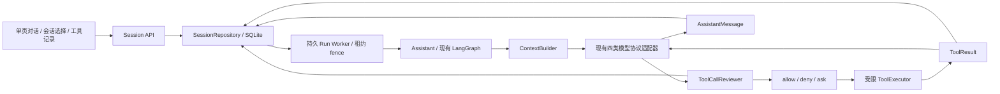

# Session 驱动的 Agent 核心与账户功能退出方案（已确认并实施）

日期：2026-11-16（Asia/Taipei）。用户明确要求移除账户/账号/余额功能，并完善 Session、UserMessage、ToolCall、ToolResult、AssistantMessage、Message、Context、Tool、Assistant、ToolCallReviewer、Decision。用户已确认完整设计并授权实施。代码与最终验证见 [SESSION_AGENT_REFACTOR_REPORT.md](SESSION_AGENT_REFACTOR_REPORT.md)。以下保留批准时的范围与取舍；实际接口/限制以 ARCHITECTURE.md / API.md / 报告为准。

## 1. 当前差距与目标

现有 `agent/`、AgentService、Scheduler、偏好与上下文都围绕 accountId/eventId/余额阈值；两个工具也是账户快照和事件读取。聊天则是独立的无状态文本 HTTP，窗口内存保存 user/assistant，工具响应会被适配器拒绝，重启清空。已有“SessionService”实际管理客户端认证令牌，不是对话 Session。

目标是保留 Electron 单页对话与模型/Key 配置，把业务核心改为独立的持久对话 Agent：

不继续保留“余额 Agent”和“聊天 Agent”两套活动业务。真实模型发出结构化工具请求，后端审核并执行；不会从普通回复文本猜测 JSON 再当作工具命令。

## 2. 两种方案与选择

| 方案 | 优点 | 代价 |
| --- | --- | --- |
| A：无状态聊天上加内存工具循环 | 改动较少，短期能演示 | 无法可靠恢复会话/审核，断开和重启丢进度，工具/消息归属弱 |
| B：持久 Session/Message/Run，复用 LangGraph、Worker 和协议层（推荐） | 状态可查询、工具可追溯、审核可恢复，符合现有后端权威和事务风格 | 需要新迁移、旧业务清理与客户端会话适配 |

采用 B。审核另比较“让 LLM 决定是否安全”和“确定性规则为权威、必要时人工确认”：采用后者。模型不能批准自己，也不能覆盖工具注册表/权限；首轮不安装通用 Agent SDK 或第二套编排框架。

## 3. 明确删除、保留和兼容边界

删除活动功能及其无用调用链：

- 账户添加/断开/重连、Mock 账户连接器、余额/用量/资源快照、自动/手动同步、旧重试和账户定时调度。
- 账户业务事件及其 SSE、余额阈值偏好记忆、旧事件 analyze/AgentRun、账户快照/事件读取两个工具。
- 对应前端死代码、WorkspaceAPI/账户余额 DTO、旧烟雾/E2E 业务步骤、账户导入运行入口与仅服务这些功能的实现测试。旧原始 SQL 与升级数据保留测试继续存在。

保留且不得破坏：

- 客户端认证 `client_sessions`、bootstrap/短会话管理、六方法 preload、CSP/隔离、窗口/托盘/通知/连接配置。认证 Session 与 Conversation Session 在类型和命名上区分。
- 0004 模型目录、九家厂商已有文本聊天、客户端选厂商/模型、Key JWE 提交、Fernet/密钥环、凭据版本/轮换与 CLI。
- 已执行 0001–0004、旧 Drizzle SQL、原有数据库及备份。**不删库、不 DROP 账户旧表、不删除原有账户记录或秘密、不修改真实用户数据目录。**

旧 ORM 表定义集中为仅迁移/归档使用的元数据，防止 Alembic 将保留表误当成可删除；活动 Service/Worker 不查询/写入它们。旧 pending/running 等记录保留原状态作为历史，不再被新 Worker 执行。账户导入代码退出活动 CLI，不将“保留历史数据”变成继续维护账户业务。

旧账户/连接器/同步/事件/阈值/快照/旧分析端点停止提供能力；使用固定 `410 FEATURE_REMOVED` 明确退役，不假返回空数据。认证、health/system/status、模型目录/配置/凭据端点保持；`POST /chat/completions` 暂保留为原无状态文本兼容 API，底层共用模型网关，不引入工具或隐式写会话。

删除会影响当前未提交的旧业务源文件：实施前对相关源代码/学习注释做不含私有数据的本地备份；保留其余未提交模型/凭据/客户端工作，不自动提交、推送或发布。

## 4. 领域对象与职责

| 名称 | 职责与关键约束 |
| --- | --- |
| Session | 持久对话容器：id、title、profileId/Mock、reviewMode、revision、时间/归档状态；不是客户端认证 Token |
| Message | 判别联合与公共 envelope：id、sessionId、runId、sequence、kind、createdAt；统一排序/分页，没有任意 role 写入口 |
| UserMessage | 用户文本及 clientMessageId；同 Session/clientMessageId 唯一，重放同请求不重复创建运行，不同内容冲突 |
| AssistantMessage | 模型公开文本、final/intermediate、usage/截断/失败状态；用户不能伪造提交，工具阶段文本不代表本轮完成 |
| ToolCall | 服务器内部 id、providerCallId、run/round、固定工具名/version、不可变参数、参数摘要、执行状态；不是可执行任意函数的字符串 |
| ToolResult | 唯一关联 ToolCall，成功输出或固定失败/拒绝/取消信息；不得串 Session/Run 或接受客户端伪造结果 |
| Context | 为一个 Run 选择的消息窗口、系统策略版本、工具说明、选中消息边界、预算/裁剪摘要；与持久会话历史分开 |
| Tool | 现有 Registry/Definition/Executor 的通用化：Pydantic 参数/输出、能力、版本、只读属性、超时与范围依赖 |
| Assistant | 注入 ModelGateway、ContextBuilder、Registry、Reviewer、Executor/Repository 的运行对象，驱动现有 StateGraph；不另建无用途的 Assistant 管理后台 |
| ToolCallReviewer | 在执行前检查工具白名单、参数、Session 允许能力、预算和审核模式，返回并持久化 Decision；不直接执行工具 |
| Decision | allow/deny/ask、固定 reasonCode、来源 policy/human、策略版本、toolCallId、revision/过期时间；模型输出不是 Decision 权威 |

Session 保存 Assistant 的选定模型/工具/审核配置，Assistant 是运行对象，不为名字机械建立一张空表。Message 对 ToolCall/ToolResult 可引用其唯一记录，API 拼装有类型的公开对象，避免同一参数/结果多处成为权威。

## 5. 一个真实可验证的工具闭环

首轮只注册与账户无关的两项本地工具：

- `get_current_time`：返回注入时钟的 UTC 时间，无账户/密钥/环境变量访问。
- `calculate`：对有界十进制数字做加减乘除，严格参数/精度/输出边界，除零是固定失败；不使用 eval/exec、任意表达式、文件或 shell。

保留可注入 MockAssistant/MockModel 供无 Key 的确定性测试，实际工具执行、审核、持久化使用同一路径。真实会话使用用户选择的模型调用“提出工具 → 审核 → 执行 → 回传结果 → 最终回答”，没有自动切换 Mock/厂商。

审核模式按 Session 创建时确定：

- `auto_readonly`（默认）：仅这两项已注册只读工具满足参数/预算时 allow；不满足则 deny。
- `ask`：先完成同样的规则校验，再将合法调用保存为等待人工确认，界面显示批准/拒绝。人工批准也不能放行未知/非法工具。
- `disabled`：纯文本会话，不向模型声明工具；适用于不支持工具的实际模型，不在失败后偷偷降级。

ask 不保留占用中的异步任务：持久化 waiting_review 后释放 Worker 名额，用户决定后再入队。人工提交只接受 toolCallId + approve/reject + expectedRevision，不接受改名/改参数；与 Session/Run/参数摘要/策略版本绑定，重复同决定幂等、冲突 409，过期 10 分钟不得执行。拒绝产生匹配 ToolResult 供模型继续，不伪造成功。

不提供 shell、任意 HTTP、文件读写、账户查询、MCP 扩展或外部写工具；未来增加工具仍需单独定义最小权限与审核规则。

## 6. 模型协议与服务端私有续接状态

复用现有 httpx 和四类 Adapter，新增统一 `AssistantTurn`（公开文本、ToolCall 提议、finish/usage、服务端私有 continuation），旧文本接口使用同一网关的 tools=[] 模式。九家预设不等于每个用户填写的模型 ID 都支持工具；不支持或格式不合法时明确错误，保留纯文本模式。

官方协议核对依据：

- [OpenAI Function Calling](https://developers.openai.com/api/docs/guides/function-calling)：Responses 以 function_call/call_id 对应 function_call_output，原有 store=false 保留；所需 reasoning 续接项保留在服务端，不向界面暴露。[OpenAI reasoning](https://developers.openai.com/api/docs/guides/reasoning)
- [Claude Handle tool calls](https://platform.claude.com/docs/en/agents-and-tools/tool-use/handle-tool-calls)：tool_use.id 对应 tool_result.tool_use_id，结果必须按协议紧接调用，不将工具结果冒充用户自然语言。
- [Gemini generateContent Function Calling](https://aistudio.google.com/docs/function-calling?generate-content=true&hl=en)：functionCall/functionResponse 对应，必要 thoughtSignature 保留原 Part/顺序；本次不擅自迁移到 Interactions API。
- [DeepSeek Tool Calls](https://api-docs.deepseek.com/guides/tool_calls/) / [Thinking Mode](https://api-docs.deepseek.com/guides/thinking_mode/)：Chat Completions 的 tool_calls/tool_call_id，思考模式下必要 reasoning_content 回传不能丢失。其余兼容厂商在实施时继续核对各自官方约束，不猜路径/参数或自动切换 beta 端点。

厂商原始续接字段不混进公开 Message/Context 摘要或普通日志。仅白名单、有限大小的协议续接状态保留在服务端；需持久化的私有字段以现有 Fernet 密钥环加密，绑定 profile/Session/Run/round，轮换一并覆盖。不得把 SecretStore、真实 API Key、全量 Services 交给 Context/工具/LLM；模型认证仍只由网关处理。模型响应含实际 Key 回显时拒绝落库/返回。

不会宣称保留的这些步骤等于完整 LangGraph checkpoint；首轮通过持久 Run/模型轮次/工具步骤实现受控恢复，不为此增加 checkpoint 插件依赖。

## 7. 持久化、事务和恢复

新增 Alembic `0005_session_agent_core`，旧表不改不删。建议表：conversation_sessions、conversation_messages、assistant_runs、assistant_tool_calls、assistant_tool_results、assistant_reviews、assistant_model_turns。Context 快照放 Run，私有续接密文放模型轮次，不为每个领域名字单独造表。

- UserMessage、Run 入队、Session revision/sequence 同事务；唯一 clientMessageId 和每 Session 一个活动 Run 的约束防双击与乱序。
- 复用数据库队列/领导租约/fence，移除账户定时分支，只处理 AssistantRun；所有模型响应/工具结果/最终回复提交重新检查当前归属和取消状态。
- 模型提议批次、ToolCall 和审核决定同事务；ToolResult 与对应 Message/下一阶段推进同事务，工具结果唯一约束阻止重复提交，不能把“有调用记录”误认为执行已成功。
- 模型请求之前记轮次状态。重启后 pending 可继续，已保存的合法只读步骤可恢复；**正在外部调用且响应未持久化的轮次标记 interrupted/unknown，不自动重发付费请求**，由用户明确重试。已完成的工具结果复用，未确认只读执行可有限恢复并记录 attempts。
- 用户重试建立关联的新 Run，复用原 UserMessage，不重复插入用户文本；不承诺厂商未计费或外部 Exactly-once。自动协议失败/限流不隐式重试或换厂商。
- 停止使用显式取消 API 写终态/取消请求；只 abort 客户端轮询不等于取消后台 Run。超时/取消不能硬杀底层线程，名额保持到结束，晚到结果拒绝提交。

初始预算：每 Session 1 个活动 Run，Worker/进程最多 2 个活动模型请求，每 Run 最多 4 轮模型/8 次工具提议，工具顺序执行；单工具 2 秒/结果 8 KiB/参数 4 KiB，单模型响应沿用 256 KiB、等待 60 秒，Run 活动预算 180 秒（人工等待另计）。预算内未得最终文本则明确失败/超限，不伪装成功。实现中以可注入配置和故障测试验证，不把预算称为硬实时。

## 8. Context 与会话 UI

ContextBuilder 用持久历史构建窗口，初始总输入预算 64 KiB UTF-8（含系统策略/工具说明/必要私有续接），这不是精确 token 数。只裁剪更早的完整轮次，工具调用/结果成组保留，当前用户消息和未完成工具链不单独丢弃。记录采用的 sequence 边界/策略版本/裁剪轮数；必要内容放不下时明确报错，不伪造摘要。Context 在 Run 首次开始时冻结，恢复不混入后来消息。

客户端继续单页对话，仅增加小型会话列表/切换、工具与审核记录的折叠展示、等待审核时的批准/拒绝。新对话创建新 Session，旧 Session 可切回，重启恢复；切换模型/审核模式创建新会话，避免旧历史被自动发送到另一模型。消息正文保持纯文本，不渲染模型 HTML。

连接后 Mock 与真实模型都可走服务端 Session 持久链路；离线仍可保留现有明确标注的本地演示，但不自动上传/合并离线聊天。会话内容现在会被有意存盘，文档明确不等于长期记忆，默认不做自动记忆提取/RAG。

首轮保持非 token 流式，用持久状态 REST 轮询/分页更新，避免把 SSE 当唯一真相；以后需要流式可在同一 Run/Message 契约上扩展。

## 9. API 草案与兼容

所有新接口沿用现有认证、精确 Origin/Host、no-store、HTTP 大小上限和 Pydantic/OpenAPI/Zod：

| 接口 | 语义 |
| --- | --- |
| POST /api/v1/sessions | profileId 或 Mock、reviewMode；创建持久会话 |
| GET /api/v1/sessions | 游标/limit，稳定创建顺序的会话摘要 |
| GET /api/v1/sessions/{id} | 公开设置、revision、活动 Run 摘要 |
| GET /api/v1/sessions/{id}/messages | afterSequence/beforeSequence/limit，按确定顺序返回 Message 判别联合 |
| POST /api/v1/sessions/{id}/messages | 只接受 UserMessage 内容/clientMessageId/expectedRevision；202 返回消息与 Run ID，不接受 assistant/tool/Context/policy 原文 |
| GET /api/v1/sessions/{id}/runs/{runId} | 状态、公开上下文摘要、工具/审核/usage/固定错误，不含私有续接 |
| POST /api/v1/sessions/{id}/runs/{runId}/cancel | 持久取消；已结束幂等 |
| POST /api/v1/sessions/{id}/runs/{runId}/retry | 显式重试中断/失败/取消 Run，不重复 UserMessage |
| POST /api/v1/sessions/{id}/tool-calls/{callId}/decision | approve/reject/expectedRevision，绑定已有合法提议，不接受客户端 ToolResult |
| GET /api/v1/tools | 仅返回已注册工具的公开 schema/版本/只读能力 |

对话 Session 与 `/auth/session` 不冲突。模型/Key 路径和旧文本接口 DTO 兼容。退役账户端点明确 410，不在新 OpenAPI 中继续广告旧业务能力。

## 10. 实施顺序与质量门禁

编码前执行 `git diff --check` 通过；`pnpm lint` 的 ESLint 通过，Ruff 报告既有 `backend/app/agent/graph.py` 导入区/顶层注释间空行格式（I001）。该文件在本轮替换范围内，将在实施时保留适用学习注释并修正；当前未为设计阶段改运行源码，不把基线 lint 写成通过。

按依赖顺序实施一个完整最小闭环，不逐步重复请求已确认的授权：

1. 锁定旧业务引用/备份源代码，建立核心类型/新迁移/Repository；新增保留旧数据与模型 Key 的升级测试。
2. Session/UserMessage/AssistantRun 与查询/取消/重试的持久 API、通用 Worker/fence；退出账户 Runtime/API，模型/凭据链路保持。
3. Context/Tool/Reviewer/Decision/ToolResult 与 Mock、真实四协议工具循环；必要的私有续接加密与轮换验证。
4. 单页客户端接持久 Session、工具审计/人工审核，更新 shared/生成协议、删除账户死代码和专属测试/脚本。
5. 更新 ARCHITECTURE、ADR、API、学习/评测/操作与 AGENTS；最终做依赖扫描，无活动余额引用，历史迁移/归档允许保留旧词。

测试不预承诺固定数量，至少验证：

- Session/message 分页/排序/归属、clientMessageId 幂等/冲突、每 Session 并发、重启恢复、旧数据/Key/0001–0004 不变；认证 Session 不受影响。
- 四协议提出工具→关联回传→最终文本，多个 ToolCall/无文本调用、未知工具/非法参数/拒绝/错误/预算/错误 ID、私有签名/续接不丢失、不进入公开 API/日志，真实 Key 回显拒绝。
- Reviewer allow/deny/ask、人工重复/冲突/过期/跨 Session/改参数/取消后批准；审批不能越过白名单，拒绝工具产生可关联的失败结果。
- Context 预算与完整工具链、冻结历史、Prompt Injection 不升级权限、模型不允许控制系统提示/secretRef/Session 归属；工具无账户/密钥/任意系统访问。
- 模型请求断开/线程迟到、Worker 崩溃/失租/换 fence、未知付费请求不自动重发、工具结果事务/唯一约束、手动重试不重复用户文本。
- `pnpm api:generate`、lint/typecheck/相关单元集成/build、独立 backend/model/Agent smoke、真实开发/E2E/未签名包；桌面重启会话保留、工具状态/批准拒绝、新对话/停止/模型 Key 回归。
- Docker 改 Worker 后区分配置检查、镜像构建和实际容器业务；可用时实际跑隔离 Compose，不能沿用旧账户 smoke 宣称新 Agent 验证。

真实厂商付费请求不由自动测试发出，使用合成 Key 和 HTTP 协议替身覆盖运行链路；用户实际模型/权限/额度及正式签名/公网多用户生产仍需独立验收。上一轮已知偶发 Key 提交 422 原因未确认，按回归实际结果记录，不用盲重试掩盖。

## 11. 学习练习

用普通前后端知识解释：Session 像会话表，Message 像有类型的子记录，Context 像发给模型的一次请求 DTO，Tool 像受限 Service 方法，ToolCallReviewer 像执行前的权限拦截，Decision 是可审计结果。

小练习：画出“用户要求计算 12÷3 → 模型提议 calculate → ask → 用户拒绝 → denied ToolResult → 模型解释”的状态图，说明为什么拒绝不能写成计算结果 0、为什么不能由客户端直接 POST 一个成功 ToolResult，以及断网后应查询哪个持久 ID。
